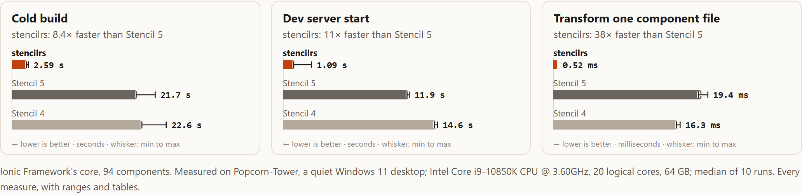

# stencilrs

[](https://github.com/popcorn245/StencilRS/actions/workflows/ci.yml)
[](https://www.npmjs.com/package/@popcorn245/stencilrs)
[](LICENSE)

**[Stencil v5](https://github.com/stenciljs/core/tree/v5) components, compiled by Rust.**

stencilrs replaces the slow part of the Stencil compiler: the TypeScript transform layer that turns
a component file (`@Component`, `@Prop`, `@State`, JSX…) into a working custom element. It is a
Rust port on [oxc](https://oxc.rs), runs as a Vite 8 plugin, and produces **the same output as
Stencil v5**: about **22× faster per file** and **2.9× faster** for a production Vite build. From a
fresh process, with module load counted, a build is about **4.8× faster** and the dev server answers
its first request about **2.9× sooner** than Stencil v5's (measured on the reference Windows machine,
[details](https://popcorn245.github.io/StencilRS/benchmarks.html#cold-start-a-fresh-process)).

You write components exactly as you would for Stencil v5. stencilrs compiles them, and Stencil's
own runtime (`@stencil/core`) runs them in the browser.

[](https://popcorn245.github.io/StencilRS/benchmarks.html)

Ionic's core, built three ways (lower is better; bars are medians of 10 runs, whiskers min to max; measured on a quiet
Windows 11 desktop, i9-10850K, 64 GB). Every measure, the watch rebuild included (stencilrs 2× faster than Stencil 5 since
[#85](https://github.com/popcorn245/StencilRS/issues/85)), is a chart on the
[Benchmarks page](https://popcorn245.github.io/StencilRS/benchmarks.html), drawn from the data files.

**Docs and live components:** [popcorn245.github.io/StencilRS](https://popcorn245.github.io/StencilRS/)

## Install

```sh
npm install --save-dev @popcorn245/stencilrs vite@8 \
  @stencil/core@5.0.0-beta.25 @stencil/unplugin@5.0.0-beta.25
```

Node 22 or newer. Prebuilt binaries ship for Linux x64/arm64 (glibc 2.17+, and musl, so Alpine
works), macOS x64/arm64 and Windows x64; no Rust toolchain needed. On any other platform the
loader fails with an error naming it; you can [build from source](#develop). Install with optional
dependencies on (no `--omit=optional`), since npm delivers the binary as one.

## Use it with Vite

```ts
// vite.config.ts
import stencilrs from '@popcorn245/stencilrs/vite';
import { defineConfig } from 'vite';

export default defineConfig({ plugins: [stencilrs()] });
```

```json
// tsconfig.json (the parts that matter)
{
  "compilerOptions": {
    "experimentalDecorators": true,
    "jsx": "react-jsx",
    "jsxImportSource": "@stencil/core"
  }
}
```

Import a component module anywhere and its custom element is registered:

```ts
import './components/my-counter/my-counter';
```

The plugin compiles component files, their stylesheets and the build flags with stencilrs, and
loads neither `@stencil/unplugin` nor Stencil's compiler (TypeScript, ~700 ms) unless it has to. A
file that uses something stencilrs hasn't ported yet falls back to Stencil's own compiler, loaded
at that point, so a project never breaks for want of a feature
([what is where](docs/vite-plugin.md)). The `docs`, `types`, `include` and `exclude` options are
done the same way: `import cem from '@stencil/unplugin/docs'` and `components.d.ts` come from
stencilrs' own metadata, and only a file with a type it hasn't ported yet takes its metadata
from Stencil's compiler.

### Type declarations for a library

`stencilrs({ dts: true })` writes `components.d.ts` beside the build output, as `stencil build`'s
`types` output does: an `HTML<Name>Element` interface per component with its props and methods,
the tag in `HTMLElementTagNameMap`, typed custom events, and JSX `IntrinsicElements` (with the
`attr:` / `prop:` forms). Every name comes from the tag, as Stencil's does (`ion-accordion` is
`HTMLIonAccordionElement`, `Components.IonAccordion`, `LocalJSX.IonAccordion`), whatever the class
is called. It is off by default. `dts: { fileName: 'types/components.d.ts' }` picks the path inside the output directory.
`generateTypes([{ file, source }], { outFile })` does the same without Vite.

Types a component imports from its own relative modules are imported again relative to the `.d.ts`,
so ship declarations at those paths too, or call `generateTypes` with `outFile` next to the sources.
A type that cannot be resolved (a local type that isn't exported, for example) becomes `any`, with a
build warning. Differences from `stencil build`'s file that remain: a prop whose type the source never
writes (`@Prop() mode = getIonMode(this)`) and a `@Method` without a return annotation are `any` /
`Promise<any>` (there is no checker to infer them), and import aliases for same-named types from
different files may be numbered differently.

### Type-check the build

stencilrs transpiles and never type-checks; `stencil build` does. `stencilrs({ typecheck: true })` runs
the checker for you, off by default (nothing changes without it):

```ts
stencilrs({ typecheck: true });
stencilrs({ typecheck: { tsconfig: 'tsconfig.app.json', bin: 'tsc' } });
```

- It runs `tsgo` (`@typescript/native-preview`, about 5x faster than `tsc`) when that package resolves from
  the project root, else `tsc` from `typescript`, else the build stops with a message that says what to
  install. `bin: 'tsgo' | 'tsc' | 'tsrs' | 'tsc-rs'` forces one; the two Rust checkers (below) are used only when named. `tsconfig` (default `tsconfig.json`, relative to the root)
  picks the config. It runs `--noEmit --skipLibCheck` (what `stencil build` forces), in a child process
  started without a shell.
- The four checkers, on Ionic core (362 files, `--noEmit --skipLibCheck`, median of 7 interleaved runs on a shared
  4-core container; see [the spike](docs/spike-rust-typecheckers.md)):

  | `bin` | Package | Implements | Ionic median |
  |---|---|---|---:|
  | `tsc` | `typescript` | TypeScript 6.0.3 (what Stencil v5 pins) | 5.9 s |
  | `tsgo` | `@typescript/native-preview` | TypeScript 7.0 dev | 1.4 s |
  | `tsc-rs` | `tsc-rs` ([pingdotgg/ts-rust](https://github.com/pingdotgg/ts-rust)) | TypeScript 7.1 beta | 0.39 s |
  | `tsrs` | `tsrs` ([oxc-project/tsrs](https://github.com/oxc-project/tsrs)) | TypeScript 7.1 beta | 0.26 s |

  `tsrs` and `tsc-rs` implement TypeScript 7.1, not 6.0, so a project on TypeScript 6 can see new errors
  (Ionic reports one: its own `CloseWatcher` type conflicts with the 7.1 `lib.dom.d.ts`; official
  `typescript@7.1.0-beta` reports it too). Both are pre-1.0 releases. Otherwise their diagnostics matched
  `tsc` on Ionic and ui-kit, including injected TS2322, TS6133 and TS2339. They are opt-in for that reason.
- `vite build`: the checker starts at `buildStart`, so it overlaps the build, and is awaited before the
  bundle is written. A type error fails the build with the checker's diagnostics and writes no output.
- `vite` (dev) and `vite build --watch`: it runs once at start and again after a change to a
  TypeScript or JSON file (debounced, and a run still going is killed). The result goes to Vite's logger;
  a response is never held back for it, and a failed check does not stop the server.
- With `dts` on and a written build, the check starts after the output files, `components.d.ts`
  included, are written, so it sees the fresh declarations when your tsconfig includes them (this gives
  up the overlap with the write step; type errors then leave the output on disk). Without `dts`, keep a
  checked-in `src/components.d.ts` as Stencil projects do.

For a ready project (dev server, component generator, tests in happy-dom and headless Chrome, app
and library builds) copy [`examples/starter`](examples/starter/README.md).

## Status

| Check | Result |
|---|---|
| Same output as Stencil v5's per-file compiler, 222 fixtures, in each of five outputs | **222/222**: metadata, diagnostics and code |
| Same scoped CSS as Stencil v5's `scopeCss`: its spec, every stylesheet here, 5,000 generated | **5,386/5,386**, byte for byte |
| Same metadata as a full `stencil build`, 136-component library | **136/136** |
| That library's spec suite (874 tests) | **874/874** with either compiler |
| Per-file compile, 222 files, source maps on ([chart](site/public/img/chart-uikit-transpile.png)) | **108 ms** vs 2.4 s (22×) |
| Production `vite build` of the library ([chart](site/public/img/chart-uikit-vite-build.png)) | **1.0 s** vs 3.0 s (2.9×) |

Supported: every Stencil decorator (`@Component`, `@Prop`, `@State`, `@Event`, `@Method`,
`@Watch`, `@Element`, `@Listen`, `@AttachInternals`, `@PropSerialize`, `@AttrDeserialize`),
JSX, `styleUrl(s)` (per-mode ones too) and inline `styles` (scoped ones scoped at compile time, as Stencil does), component `globalStyle` and `globalStyleUrl`, shadow and scoped encapsulation, inheritance and mixins,
form-associated components, constants as decorator arguments and computed member names
(`@Watch(KEYS.open)`, enums, `resolveVar()`, `@Prop() [NAME]`), and source maps back to the
original TypeScript.

Not yet (these fall back to Stencil, or are tracked as issues):

- the Vite plugin's `docs` and `types` for a project with CSS-only components (`@component` in a
  stylesheet), or a `stencil.config` that can't be loaded: those go through `@stencil/unplugin`
- in the lazy (`loader-bundle`), `ssr` and spec-page outputs, decorated base classes
  and mixins with a computed `@Prop`/`@State` name or a `@Watch` options argument
- `complexType` for types that need the checker: `keyof` of anything but an object literal, a
  `const` object or an alias of those, `typeof` in an annotation, mapped and conditional types,
  intersections with a `null`, `any`, literal or `{}` member (the checker collapses those; an
  intersection with a union of objects is distributed), return types inferred from the body other
  than a promise of a boolean, a primitive `this.field`, `Promise.resolve(x)` or
  `new Promise<T>()`, inferred object types, types from packages or
  tsconfig `paths`, and unions whose member order depends on the whole
  program (`docs/quirks.md`, quirk 18; TypeScript's default sorts union members by type id, which
  depends on what the checker saw first, but with `stableTypeOrdering: true` in the tsconfig, the
  only order TypeScript 7 has, the order is a function of the types and stencilrs reproduces it).
  Object, interface, branded-primitive and `Record<never,
  never>` intersections, `Intl.*Options` lib types, generic methods, `keyof typeof const` and
  generic aliases and interfaces with defaults work, as do the element types Stencil generates
  (`HTMLIonTabElement`, when a component of the project has the tag). `analyze(..., { complexTypes: true })` reports each
  as an error starting with `stencilrs:` ([#8](https://github.com/popcorn245/StencilRS/issues/8))

## How it works

Stencil v5 already bundles with Rolldown and handles CSS with Lightning CSS. What remained slow is
its TypeScript-compiler-API transform layer (about 13.7k lines). stencilrs ports that layer to Rust
and exposes it to Node through napi-rs; everything else, including the browser runtime, is
Stencil's own.

| Layer | Stencil v5 | stencilrs |
|---|---|---|
| Decorator, JSX and component transforms | TypeScript `CustomTransformers` | Rust on oxc |
| Bundling | Rolldown | Rolldown (unchanged) |
| CSS | Lightning CSS | Lightning CSS (unchanged) |
| Browser runtime | `@stencil/core` | `@stencil/core` (unchanged) |

Parity is held by golden output: [`parity/`](parity/README.md) compiles a corpus with real
Stencil v5 and compares stencilrs against it on every change. Where Stencil has a quirk,
stencilrs copies it on purpose ([`docs/quirks.md`](docs/quirks.md)). Design notes:
[`docs/transformers.md`](docs/transformers.md), [`docs/pipeline.md`](docs/pipeline.md).

## Server-side rendering

stencilrs builds the hydrate app too: `buildHydrate` from `@popcorn245/stencilrs/ssr` turns your components into the module that
`renderToString` runs from, with a single-pass serializer and guarded runtime patches (both on by default, each can be turned
off). Its output is byte-identical to Stencil 5's `ssr` output target. On Ionic 9.0.12 (`list-50`, declarative shadow DOM), on a
quiet Windows desktop (i9-10850K, 10 cores, Node 26; medians of 200 renders; Express at 8 connections):

| | Ionic published (Stencil 4) | Stencil 5 | stencilrs |
|---|---|---|---|
| ms per render | 338 | 33.7 | **24.9** |
| Express req/s | 2.7 | 25.0 | **32.6** |
| Express req/s, 8 workers | 11.1 | 104.8 | **122.0** |

Most of the gap to Ionic's published hydrate app is Stencil 5 itself; stencilrs's part is the Stencil 5 column against its own.
Guide: [Server-side rendering](https://popcorn245.github.io/StencilRS/guide/ssr.html); all pages, cold start and memory on the
[benchmarks page](https://popcorn245.github.io/StencilRS/benchmarks.html#server-side-rendering-ionic).

## Server-render in Express

`@popcorn245/stencilrs/express` is an Express view engine that renders Stencil components on the
server. It wraps an engine you already use: EJS, Handlebars, Pug and the rest fill in the locals
as they always did, then the hydrate app's `renderToString` renders the components in the HTML
that comes out. There is no template syntax of its own, and Express is not a dependency of this
package. It reads like Stencil's server-rendering examples:

```js
import express from 'express';
import ejs from 'ejs';
import { stencilEngine } from '@popcorn245/stencilrs/express';
import * as hydrate from './dist/hydrate/index.js';

const app = express();
app.engine('ejs', stencilEngine({ hydrate, engine: ejs.renderFile, renderOptions: { serializeShadowRoot: 'declarative-shadow-dom' } }));
app.engine('html', stencilEngine({ hydrate })); // no inner engine: the file is the HTML
app.set('view engine', 'ejs');
app.get('/', (req, res) => res.render('home', { user }));
```

- `hydrate`: any hydrate app, one built by stencilrs (`componentExport: 'ssr'`) or by Stencil's own
  `ssr` output target; a module, or a path to one (loaded on the first render).
- `engine`: any `(path, locals, callback)` function (`ejs.renderFile`; wrap `pug.renderFile` or
  Handlebars to that shape). Omitted, the view file is read as HTML.
- `renderOptions`: `renderToString` options for every render. One view overrides them with the
  reserved `stencil` local: `res.render('home', { user, stencil: { serializeShadowRoot: 'scoped' } })`.
- `view cache`: when Express's setting is on (it is in production), plain HTML views are read once,
  and the flag reaches the inner engine as `cache`.
- Diagnostics: an error-level diagnostic is passed to Express as the error (`next(err)`); warnings
  go to `onDiagnostic` (default `console.warn`), once per unique message.
- `workers: n` (or `'auto'`, available parallelism minus one): render on a pool of `worker_threads`
  instead of the request thread, since `renderToString` is CPU-bound and one process renders on one
  core. Each worker loads the hydrate app once, so `hydrate` must be a path or URL (a module object
  cannot cross threads). The inner engine still runs on the main thread; only the HTML and options
  go in and `{ html, diagnostics }` comes out (about 1 ms of structured clone for a 1 MB page).
  `maxQueue` (default 100) bounds the renders waiting for a worker, `renderTimeout` (default 30 s)
  bounds one render; a crashed or timed-out worker is replaced and fails only its own render.
  `engine.ready` resolves when the workers have loaded, `engine.close()` stops them. Without
  `workers` nothing changes: renders run in-process.
- `compileCache` (default `true`): Node's on-disk compile cache (`module.enableCompileCache()`, Node 22.1+), switched on
  before the hydrate app loads, in this process and in each worker. The app is megabytes of JavaScript: on a warm cache
  its load went from about 30 ms to 13 ms in our container. `false` opts out, a string picks the cache directory, and
  Node's `NODE_DISABLE_COMPILE_CACHE` is honoured. It is process-wide (it also caches every module loaded after it), is a
  no-op on a Node without the API, and needs `hydrate` as a path (a module you imported yourself is already compiled).
  The first run writes the cache, so it pays off from the second start of a process (a restart, a new worker, a deploy
  that keeps the directory).
- `warmup`: render at startup, so the first request is not JIT-cold: a list of view paths (rendered through the inner
  engine with no locals) and HTML strings (starting with `<`), or `{ views: [...], times: 3 }` to run the list several
  times. It runs in-process and on every worker, with the engine's `renderOptions`, and `engine.ready` resolves after it
  (a failed warm-up rejects `ready`; the engine still renders). Warm with pages shaped like your real traffic: the JIT
  warms per code path, and the first list-50 render only reached its warm cost after warming with a list page, a few
  times. A cold first render of a small page fell from 55 ms to 10 ms in our container. There is no "every component"
  mode (`true` is a TypeError): bare tags are not what a page looks like, and a component that fails without props
  could take the server down at boot. Await `engine.ready` before `listen()`.
- A view that starts with a doctype or `<html>` is rendered as a document. Anything else is a
  fragment (`fullDocument: false`): its components render, but there is no `<head>`, so no styles.

[`examples/express`](examples/express) is a working app on the ui-kit's hydrate app, with tests
(EJS and plain HTML views, cache on and off, the override, the error path, warm-up and compile cache, hydration in Chromium).

## JavaScript API

```js
import { analyze, transpile } from '@popcorn245/stencilrs';

analyze(source, 'my-cmp.tsx');                // { components, diagnostics }
transpile(source, { file: 'my-cmp.tsx' });    // { code, map, components, diagnostics }
```

The full reference is in the [docs](https://popcorn245.github.io/StencilRS/).

## Develop

Needs Rust (stable) and Node 22.

```sh
git clone https://github.com/popcorn245/StencilRS.git && cd StencilRS
npm install
npm run build:native   # builds stencilrs.<platform>.node, which index.js prefers over the prebuilt one
npm test               # cargo test, then node --test
npm run parity         # compare against Stencil v5's golden output (npm --prefix parity ci first)
bash scripts/ci.sh     # everything CI runs: compiler, parity, both example projects, Storybook
```

[CONTRIBUTING.md](CONTRIBUTING.md) covers how changes are checked and what a good pull request
looks like.

## Release

Releases are automatic. Pull requests are squash-merged and their titles are
[conventional commits](https://www.conventionalcommits.org) (checked on every PR): on each merge to
`main`, [semantic-release](https://semantic-release.gitbook.io) reads the commits since the last tag
and picks the version (`fix:` patch, `feat:` minor, `BREAKING CHANGE:` major; `docs:`, `chore:`
and the like release nothing). [`release.yml`](.github/workflows/release.yml) then builds every
platform, installs each from its packed tarball on its own OS, publishes the
`@popcorn245/stencilrs-<platform>` packages (seven) and `@popcorn245/stencilrs` with provenance, and
writes the tag and the GitHub Release. It needs the `NPM_TOKEN` secret.

## License

[MIT](LICENSE). Code ported from Stencil keeps Stencil's MIT notice; see
[THIRD_PARTY_NOTICES.md](THIRD_PARTY_NOTICES.md).
