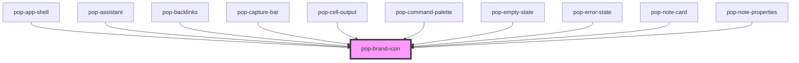

# pop-brand-icon

<!-- Auto Generated Below -->

## Properties

| Property            | Attribute      | Description                                                                                                                                                                                            | Type     | Default     |
| ------------------- | -------------- | ------------------------------------------------------------------------------------------------------------------------------------------------------------------------------------------------------ | -------- | ----------- |
| `label`             | `label`        | Accessible label. When present, the icon exposes `aria-label` + `role="img"`; otherwise it is marked `aria-hidden="true"` (decorative).                                                                | `string` | `undefined` |
| `name` _(required)_ | `name`         | The registered icon name (e.g. "star", "link", "trash").                                                                                                                                               | `string` | `undefined` |
| `size`              | `size`         | Optional explicit size; sets `font-size` on the host (e.g. "1.2rem", "20px"). When omitted the icon inherits `1em` from the host font-size, which can also be driven via the `--size` custom property. | `string` | `undefined` |
| `strokeWidth`       | `stroke-width` | Stroke weight override for the outline vectors (default 2).                                                                                                                                            | `number` | `undefined` |

## Dependencies

### Used by

 - [pop-app-shell](../../organisms/app-shell)
 - [pop-assistant](../../organisms/assistant)
 - [pop-backlinks](../../molecules/backlinks)
 - [pop-capture-bar](../../molecules/capture-bar)
 - [pop-cell-output](../../molecules/cell-output)
 - [pop-command-palette](../../organisms/command-palette)
 - [pop-empty-state](../../molecules/empty-state)
 - [pop-error-state](../../molecules/error-state)
 - [pop-note-card](../../molecules/note-card)
 - [pop-note-properties](../../organisms/note-properties)

### Graph

----------------------------------------------

*Built with [StencilJS](https://stenciljs.com/)*
