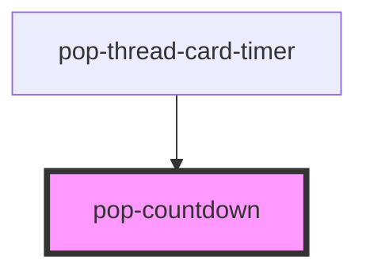

# pop-countdown

<!-- Auto Generated Below -->

## Overview

pop-countdown — a ticking H/M/S countdown to a deadline (atom).

Built for the hub Reminders panel header ("next: ⏰ Call mom in 1h 02m 05s")
but deliberately generic: give it a `deadline` (epoch ms, LOCAL clock) and it
re-renders every second, emits `popCountdownDone` ONCE when the deadline is
crossed while mounted, and shows an overdue face after that.

Clock-skew note: callers who get their deadline from a server should convert
it to local-clock terms FIRST (localNow + (serverTarget - serverNow)) and
pass that — this atom never interprets absolute server time.

  <pop-countdown deadline={msEpoch} label="Call mom" />

The interval is cleared in disconnectedCallback; changing `deadline` re-arms
the done latch (a snooze that pushes the deadline out counts down again).

## Properties

| Property      | Attribute      | Description                                                            | Type     | Default     |
| ------------- | -------------- | ---------------------------------------------------------------------- | -------- | ----------- |
| `deadline`    | `deadline`     | Target instant — epoch MILLISECONDS on the local clock. null/0 = idle. | `number` | `undefined` |
| `idleText`    | `idle-text`    | Text when there is no deadline ("No upcoming reminders").              | `string` | `''`        |
| `label`       | `label`        | Optional label rendered before the time ("Call mom — 1h 02m 05s").     | `string` | `undefined` |
| `overdueText` | `overdue-text` | Text prefix once the deadline passes (the time keeps counting UP).     | `string` | `'now'`     |

## Events

| Event              | Description                                                                                                       | Type                                 |
| ------------------ | ----------------------------------------------------------------------------------------------------------------- | ------------------------------------ |
| `popCountdownDone` | Fired ONCE when the deadline crosses ≤0 while mounted (re-armed when the deadline changes — e.g. after a snooze). | `CustomEvent<{ deadline: number; }>` |

## Dependencies

### Used by

 - [pop-thread-card-timer](../../molecules/thread-card-timer)

### Graph

----------------------------------------------

*Built with [StencilJS](https://stenciljs.com/)*
