# pop-icon

<!-- Auto Generated Below -->

## Properties

| Property | Attribute | Description                                                                                                                                                                                            | Type     | Default     |
| -------- | --------- | ------------------------------------------------------------------------------------------------------------------------------------------------------------------------------------------------------ | -------- | ----------- |
| `label`  | `label`   | Accessible label. When present, the icon exposes `aria-label` + `role="img"`; otherwise it is marked `aria-hidden="true"`.                                                                             | `string` | `undefined` |
| `name`   | `name`    | The ionicon name (e.g. "close", "checkmark", "add").                                                                                                                                                   | `string` | `undefined` |
| `size`   | `size`    | Optional explicit size; sets `font-size` on the host (e.g. "1.2rem", "20px"). When omitted the icon inherits `1em` from the host font-size, which can also be driven via the `--size` custom property. | `string` | `undefined` |
| `src`    | `src`     | Pass-through SVG src URL (alternative to `name`).                                                                                                                                                      | `string` | `undefined` |

## Dependencies

### Used by

 - [pop-bottom-nav](../../molecules/bottom-nav)
 - [pop-card-detail](../../organisms/card-detail)
 - [pop-composer](../../organisms/composer)
 - [pop-feedback-button](../../organisms/feedback-button)
 - [pop-presenter](../../organisms/presenter)
 - [pop-reminders-panel](../../organisms/reminders-panel)
 - [pop-remote-panel](../../organisms/remote-panel)
 - [pop-search-filter](../../molecules/search-filter)
 - [pop-snout-work](../../organisms/snout-work)
 - [pop-tab-bar](../../molecules/tab-bar)
 - [pop-tile](../tile)
 - [pop-view-switcher](../../molecules/view-switcher)
 - [pop-weather-panel](../../organisms/weather-panel)
 - [valheim-boss-schedule](../../organisms/valheim-boss-schedule)
 - [valheim-shop](../../organisms/valheim-shop)
 - [valheim-standings-board](../../organisms/valheim-standings-board)
 - [valheim-warriors](../../organisms/valheim-warriors)

### Graph

```mermaid
graph TD;
  pop-bottom-nav --> pop-icon
  pop-card-detail --> pop-icon
  pop-composer --> pop-icon
  pop-feedback-button --> pop-icon
  pop-presenter --> pop-icon
  pop-reminders-panel --> pop-icon
  pop-remote-panel --> pop-icon
  pop-search-filter --> pop-icon
  pop-snout-work --> pop-icon
  pop-tab-bar --> pop-icon
  pop-tile --> pop-icon
  pop-view-switcher --> pop-icon
  pop-weather-panel --> pop-icon
  valheim-boss-schedule --> pop-icon
  valheim-shop --> pop-icon
  valheim-standings-board --> pop-icon
  valheim-warriors --> pop-icon
  style pop-icon fill:#f9f,stroke:#333,stroke-width:4px
```

----------------------------------------------

*Built with [StencilJS](https://stenciljs.com/)*
