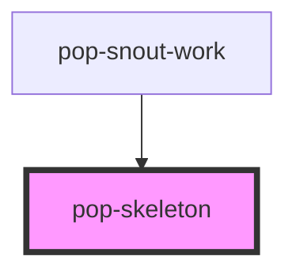

# pop-skeleton

<!-- Auto Generated Below -->

## Overview

pop-skeleton — a single shimmer placeholder block (atom). Compose several to
build a content-shaped loading state (a skeleton that mirrors the real row's
silhouette reads far better than a spinner). Size it with the `w` / `h` props
(any CSS length; `w` defaults to 100%), round it with `radius`, or make it a
circle with `circle` (uses `h` for both dimensions — for avatars / status
dots).

Always decorative: `aria-hidden`. Wrap a group in a `role="status"` region so
assistive tech announces the load once, not per block.

## Properties

| Property | Attribute | Description                                                  | Type      | Default     |
| -------- | --------- | ------------------------------------------------------------ | --------- | ----------- |
| `circle` | `circle`  | Render a circle sized `h × h` (avatars, status dots).        | `boolean` | `false`     |
| `h`      | `h`       | Height (any CSS length). Default 0.75rem.                    | `string`  | `undefined` |
| `radius` | `radius`  | Corner radius (any CSS length). Default var(--radius-sm).    | `string`  | `undefined` |
| `w`      | `w`       | Width (any CSS length). Ignored when `circle`. Default 100%. | `string`  | `undefined` |

## Dependencies

### Used by

 - [pop-snout-work](../../organisms/snout-work)

### Graph

----------------------------------------------

*Built with [StencilJS](https://stenciljs.com/)*
