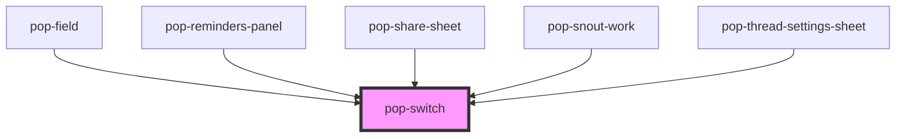

# pop-switch

<!-- Auto Generated Below -->

## Overview

pop-switch — an accessible toggle switch (atom).

The ARIA toggle extracted (behavior-verbatim) from bucket-hub's bespoke
`hub-switch` markup: a real <button role="switch">, `aria-checked`, Space/
Enter toggle (native button activation), token-driven focus ring.

  <pop-switch label="Web only" checked onPopChange={e => (on = e.detail)} />

Used standalone and by `pop-field type="boolean"`. The `label` prop is the
accessible name; render your own visible label row next to it when needed.

## Properties

| Property   | Attribute  | Description                                      | Type      | Default     |
| ---------- | ---------- | ------------------------------------------------ | --------- | ----------- |
| `checked`  | `checked`  | Whether the switch is on.                        | `boolean` | `false`     |
| `disabled` | `disabled` |                                                  | `boolean` | `false`     |
| `label`    | `label`    | Accessible name (aria-label); visually optional. | `string`  | `undefined` |

## Events

| Event       | Description                                                     | Type                   |
| ----------- | --------------------------------------------------------------- | ---------------------- |
| `popChange` | Emitted with the NEW checked state whenever the switch toggles. | `CustomEvent<boolean>` |

## Dependencies

### Used by

 - [pop-field](../../molecules/field)
 - [pop-reminders-panel](../../organisms/reminders-panel)
 - [pop-share-sheet](../../organisms/share-sheet)
 - [pop-snout-work](../../organisms/snout-work)
 - [pop-thread-settings-sheet](../../organisms/thread-settings-sheet)

### Graph

----------------------------------------------

*Built with [StencilJS](https://stenciljs.com/)*
