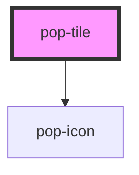

# pop-tile

<!-- Auto Generated Below -->

## Overview

pop-tile — a presentational quick-tile FACE (atom).

Renders what a tile looks like: an emoji or ionicon, a label, a chip or
square variant, an accent color, and pressed/edit states. It deliberately
knows NOTHING about what a tile *is* (Firestore docs, capabilities) or what
happens around it (drag/reorder, tap routing) — the host wraps it for DnD
and decides what `popTap` does.

  <pop-tile emoji="🌤️" label="Weather">
    72° · H 78° L 61°          <!-- rich face (default slot) -->
    3              <!-- corner badge -->
  </pop-tile>

Notes:
 - The face is a real <button> (`role` comes for free): keyboard-activatable,
   `aria-pressed` reflects `pressed`.
 - It never calls preventDefault on touch events — touch-drag arbitration
   belongs to the host's drag layer (see the hub touch-DnD gotcha).
 - The edit-mode delete button uses pop-icon (ionicons, centered) — emits
   `popDelete` and is only reachable while `editing`.

## Properties

| Property             | Attribute      | Description                                                                                                                                                                     | Type                 | Default     |
| -------------------- | -------------- | ------------------------------------------------------------------------------------------------------------------------------------------------------------------------------- | -------------------- | ----------- |
| `color`              | `color`        | Accent — any CSS color (drives the face background tint).                                                                                                                       | `string`             | `undefined` |
| `deletable`          | `deletable`    | Whether the edit-mode delete button shows at all (hosts suppress it for tiles that must never be removed, e.g. a Settings tile).                                                | `boolean`            | `true`      |
| `deleteIcon`         | `delete-icon`  | Ionicon for the edit-mode delete button — hosts repurpose it for their own remove semantics (e.g. 'eye-off-outline' = hide, 'eye-outline' = restore, 'trash-outline' = delete). | `string`             | `'close'`   |
| `deleteLabel`        | `delete-label` | Accessible name/tooltip for the delete button.                                                                                                                                  | `string`             | `'Delete'`  |
| `disabled`           | `disabled`     |                                                                                                                                                                                 | `boolean`            | `false`     |
| `editing`            | `editing`      | Edit mode: wiggle affordance + delete button.                                                                                                                                   | `boolean`            | `false`     |
| `emoji`              | `emoji`        | Emoji face (e.g. '🌤️') — mutually exclusive with `icon`.                                                                                                                       | `string`             | `undefined` |
| `icon`               | `icon`         | Ionicon name, rendered via pop-icon (used when no `emoji`).                                                                                                                     | `string`             | `undefined` |
| `label` _(required)_ | `label`        | The tile label.                                                                                                                                                                 | `string`             | `undefined` |
| `pressed`            | `pressed`      | Active/pressed visual state (reflected as aria-pressed).                                                                                                                        | `boolean`            | `false`     |
| `tileTitle`          | `tile-title`   | Tooltip for the face button. Defaults to the label.                                                                                                                             | `string`             | `undefined` |
| `variant`            | `variant`      | Square card (default) or compact chip pill.                                                                                                                                     | `"chip" \| "square"` | `'square'`  |

## Events

| Event       | Description                                                                 | Type                |
| ----------- | --------------------------------------------------------------------------- | ------------------- |
| `popDelete` | The edit-mode delete button was activated (only reachable when `editing`).  | `CustomEvent<void>` |
| `popTap`    | The face was activated (click / Enter / Space). Not emitted while disabled. | `CustomEvent<void>` |

## Dependencies

### Depends on

- [pop-icon](../icon)

### Graph

----------------------------------------------

*Built with [StencilJS](https://stenciljs.com/)*
