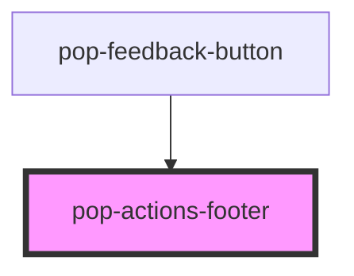

# pop-actions-footer

<!-- Auto Generated Below -->

## Overview

pop-actions-footer — the Cancel/Send pair (molecule), extracted from its two
duplicated homes (bottom-sheet `slot="actions"` markup and the
pop-form-dialog footer).

Tier-aware spacing/order:
  sheet  — full-width, stacked-friendly buttons (thumb-reachable)
  dialog — right-aligned pair
  dock   — compact inline pair

IMPORTANT: both buttons are `type="button"` (the Pico `[type=button]` /
pop-form-dialog implicit-submit gotcha) — submission is driven ONLY by the
`popSubmit` event, never by a form submit.

## Properties

| Property         | Attribute         | Description                                           | Type                            | Default    |
| ---------------- | ----------------- | ----------------------------------------------------- | ------------------------------- | ---------- |
| `busy`           | `busy`            | Busy: spinner-in-button, both buttons disabled.       | `boolean`                       | `false`    |
| `cancelLabel`    | `cancel-label`    |                                                       | `string`                        | `'Cancel'` |
| `submitDisabled` | `submit-disabled` |                                                       | `boolean`                       | `false`    |
| `submitLabel`    | `submit-label`    |                                                       | `string`                        | `'Send'`   |
| `tier`           | `tier`            | Presentation tier the footer sits in (spacing/order). | `"dialog" \| "dock" \| "sheet"` | `'dialog'` |

## Events

| Event       | Description | Type                |
| ----------- | ----------- | ------------------- |
| `popCancel` |             | `CustomEvent<void>` |
| `popSubmit` |             | `CustomEvent<void>` |

## Dependencies

### Used by

 - [pop-feedback-button](../../organisms/feedback-button)

### Graph

----------------------------------------------

*Built with [StencilJS](https://stenciljs.com/)*
