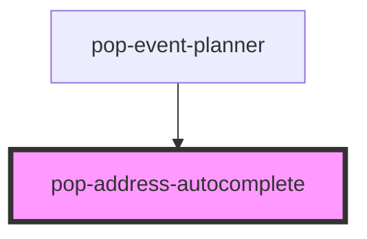

# pop-address-autocomplete

<!-- Auto Generated Below -->

## Properties

| Property      | Attribute     | Description | Type     | Default                 |
| ------------- | ------------- | ----------- | -------- | ----------------------- |
| `apiKey`      | `api-key`     |             | `string` | `undefined`             |
| `placeholder` | `placeholder` |             | `string` | `'Enter a location...'` |
| `value`       | `value`       |             | `string` | `''`                    |

## Events

| Event             | Description | Type                                                                              |
| ----------------- | ----------- | --------------------------------------------------------------------------------- |
| `addressSelected` |             | `CustomEvent<{ address: string; lat?: number; lng?: number; placeId?: string; }>` |

## Dependencies

### Used by

 - [pop-event-planner](../../organisms/event-planner)

### Graph

----------------------------------------------

*Built with [StencilJS](https://stenciljs.com/)*
