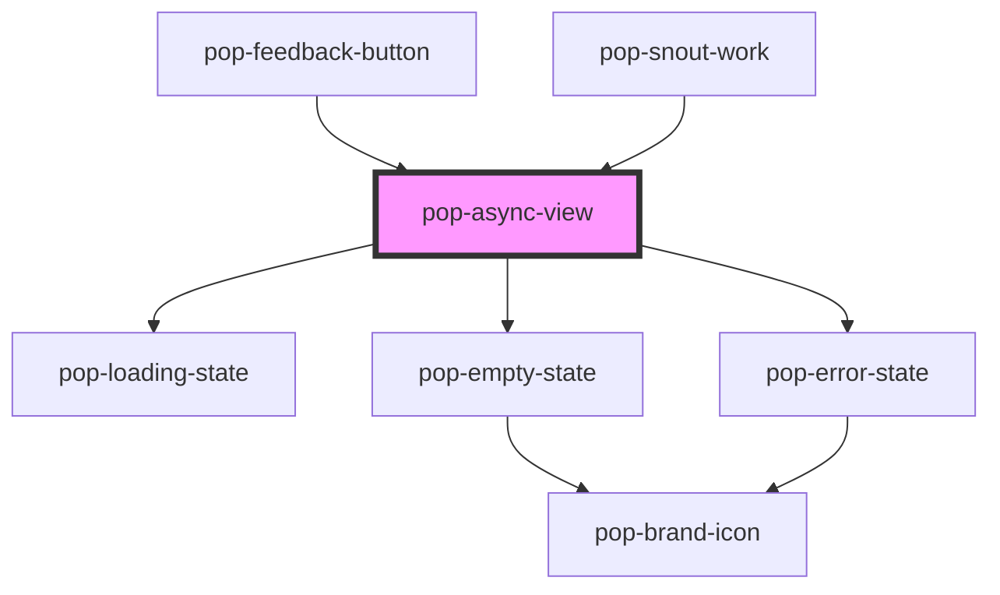

# pop-async-view

<!-- Auto Generated Below -->

## Overview

pop-async-view — declarative loading / empty / error / content states for any
data-backed region (molecule).

Pairs with `pop-sync-status`: sync-status shows FRESHNESS (last synced /
revalidating / stale), this shows LIFECYCLE (is there anything to render at
all). Composes the existing state primitives (`pop-loading-state`,
`pop-empty-state`, `pop-error-state`) for its defaults; each state slot can
be overridden.

  <pop-async-view state={view} onPopRetry={() => data.refresh()}>
    …content…
    
custom skeleton
   <!-- optional -->
  </pop-async-view>

Consumer rule (the hub cache philosophy): content stays MOUNTED during
revalidation — `state="loading"` is for the COLD hydrate only. All four
regions stay in the DOM (visibility toggled by CSS) so slotted content is
never torn down by a state flip.

AsyncData mapping: status 'loading' with no data → "loading"; error with no
data → "error" (retry → refresh()); data present → "content"; empty result →
"empty" (the consumer decides emptiness).

## Properties

| Property     | Attribute     | Description                                       | Type                                           | Default                  |
| ------------ | ------------- | ------------------------------------------------- | ---------------------------------------------- | ------------------------ |
| `emptyLabel` | `empty-label` | Default empty-state message (default empty slot). | `string`                                       | `'Nothing here yet'`     |
| `errorLabel` | `error-label` | Default error-state message (default error slot). | `string`                                       | `'Something went wrong'` |
| `retryLabel` | `retry-label` | Default retry button label (default error slot).  | `string`                                       | `'Retry'`                |
| `state`      | `state`       | Which region shows.                               | `"content" \| "empty" \| "error" \| "loading"` | `'loading'`              |

## Events

| Event      | Description                                        | Type                |
| ---------- | -------------------------------------------------- | ------------------- |
| `popRetry` | The default error state's retry button was tapped. | `CustomEvent<void>` |

## Dependencies

### Used by

 - [pop-feedback-button](../../organisms/feedback-button)
 - [pop-snout-work](../../organisms/snout-work)

### Depends on

- [pop-loading-state](../loading-state)
- [pop-empty-state](../empty-state)
- [pop-error-state](../error-state)

### Graph

----------------------------------------------

*Built with [StencilJS](https://stenciljs.com/)*
