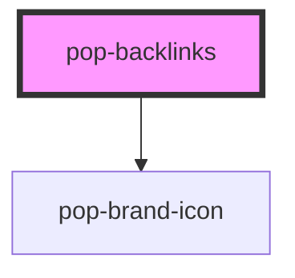

# pop-backlinks

"Linked references" / what-links-here list for the notes-app digital brain
(Phase 3). Rendered inside the properties rail's backlinks slot.

The host computes backlinks via the NotesAdapter — Dexie
`where('links').equals(noteId)` offline-primary, mirrored by Firestore
`array-contains` — and passes them via `items`. Presentational only: each item
shows the source note title + optional snippet; activating emits `open(id)`.

<!-- Auto Generated Below -->

## Properties

| Property  | Attribute | Description                                                                                                                                           | Type                       | Default |
| --------- | --------- | ----------------------------------------------------------------------------------------------------------------------------------------------------- | -------------------------- | ------- |
| `items`   | `items`   | Backlink source notes. Accepts a BacklinkItem[] (set as a DOM property) or a JSON string (so it can be used declaratively / in Storybook attributes). | `BacklinkItem[] \| string` | `[]`    |
| `loading` | `loading` | Loading state — show skeleton rows while the query resolves.                                                                                          | `boolean`                  | `false` |

## Events

| Event  | Description                                                   | Type                  |
| ------ | ------------------------------------------------------------- | --------------------- |
| `open` | Emitted with the source note id when a backlink is activated. | `CustomEvent<string>` |

## Dependencies

### Depends on

- [pop-brand-icon](../../atoms/brand-icon)

### Graph

----------------------------------------------

*Built with [StencilJS](https://stenciljs.com/)*
