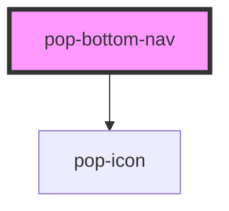

# pop-bottom-nav

<!-- Auto Generated Below -->

## Overview

`pop-bottom-nav` — a DETACHED, rounded bottom navigation bar with a large
center action button in `--grad-brand` (docs planned/yugioh-app/
ui-and-pop-bottom-nav). Two tab destinations flank each side of the center
button (the 2+2 layout); the bar floats above the bottom safe-area
(`env(safe-area-inset-bottom)` lift, borrowed from pop-nav-bar's bottom
variant) with `--radius-lg` + `--shadow-pop`.

The component is PRESENTATION ONLY — it decides nothing:
 - `tabselect {id}` fires on a tab press; the parent routes.
 - `centerpress {action}` fires on the center button; the parent opens the
   scanner or the add sheet. `centerAction` is parent-driven (an allowlisted
   non-scan user gets `"add"`; a scan-capable user gets `"scan"`) — the
   center button ALWAYS renders.
 - The `center` slot fully overrides the center button's content when the
   default icon+label pair isn't enough.

`compact` mirrors pop-tab-bar's CONTAINER-query pattern: under 400px of bar
width, tab labels visually collapse (kept in the DOM for a11y).

NOTE: "fab" in this repo means the Fabulous theme — this component is
deliberately NOT named pop-fab, and there are no `--fab-*` tokens.

## Properties

| Property       | Attribute       | Description                                                                                                                                               | Type                  | Default     |
| -------------- | --------------- | --------------------------------------------------------------------------------------------------------------------------------------------------------- | --------------------- | ----------- |
| `activeId`     | `active-id`     | Which tab is current (drives the active style).                                                                                                           | `string`              | `undefined` |
| `centerAction` | `center-action` | What the center button does — the PARENT decides ('scan' or 'add').                                                                                       | `"add" \| "scan"`     | `'scan'`    |
| `centerIcon`   | `center-icon`   | Ionicon for the center button; defaults per `centerAction` (scan → camera, add → add).                                                                    | `string`              | `undefined` |
| `centerLabel`  | `center-label`  | Tiny label under the center button; defaults per `centerAction`. Pass '' to hide.                                                                         | `string`              | `undefined` |
| `compact`      | `compact`       | Collapse tab labels when the BAR (container, not viewport) is under 400px — the pop-tab-bar compact pattern.                                              | `boolean`             | `false`     |
| `disabled`     | `disabled`      | Disable the whole bar (e.g. offline).                                                                                                                     | `boolean`             | `false`     |
| `items`        | `items`         | JSON array of the tab destinations ({id,label,icon,href?,badge?}). The first half renders left of the center button, the rest right (2+2 with four tabs). | `string`              | `'[]'`      |
| `position`     | `position`      | Detached-fixed (default) floats above the viewport bottom + safe area; `static` renders in place (Storybook frames / in-page use).                        | `"fixed" \| "static"` | `'fixed'`   |

## Events

| Event         | Description                                                   | Type                                        |
| ------------- | ------------------------------------------------------------- | ------------------------------------------- |
| `centerpress` | Center button pressed — parent opens the scanner / add sheet. | `CustomEvent<{ action: "add" \| "scan"; }>` |
| `tabselect`   | Tab pressed — parent routes.                                  | `CustomEvent<{ id: string; }>`              |

## Dependencies

### Depends on

- [pop-icon](../../atoms/icon)

### Graph

----------------------------------------------

*Built with [StencilJS](https://stenciljs.com/)*
