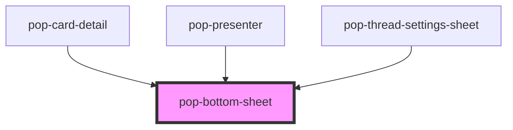

# pop-bottom-sheet

<!-- Auto Generated Below -->

## Properties

| Property     | Attribute     | Description | Type      | Default     |
| ------------ | ------------- | ----------- | --------- | ----------- |
| `fullScreen` | `full-screen` |             | `boolean` | `false`     |
| `maxHeight`  | `max-height`  |             | `string`  | `'85dvh'`   |
| `open`       | `open`        |             | `boolean` | `false`     |
| `sheetTitle` | `sheet-title` |             | `string`  | `undefined` |

## Events

| Event      | Description | Type                |
| ---------- | ----------- | ------------------- |
| `popClose` |             | `CustomEvent<void>` |

## Dependencies

### Used by

 - [pop-card-detail](../../organisms/card-detail)
 - [pop-presenter](../../organisms/presenter)
 - [pop-thread-settings-sheet](../../organisms/thread-settings-sheet)

### Graph

----------------------------------------------

*Built with [StencilJS](https://stenciljs.com/)*
