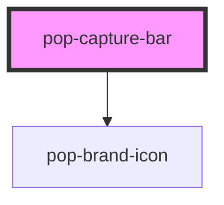

# pop-capture-bar

<!-- Auto Generated Below -->

## Overview

pop-capture-bar — zero-friction quick capture, pinned at the top of Home.

"✎ Capture a thought… ↵". Pressing Enter (or the send button) emits
`capture` with the trimmed text and clears the field (the save-and-clear
loop). The page wires note creation via the NotesAdapter — the bar itself is
presentational, so it works in Storybook and stays reusable.

Phase 2 keeps the input plain; inline `#tag` / `[[link]]` parsing
(pop-mention-input) is layered in by the Capture/Linking phases.

See planned/notes-app-digital-brain/components.mdx §pop-capture-bar.

## Properties

| Property      | Attribute     | Description                                                           | Type      | Default                |
| ------------- | ------------- | --------------------------------------------------------------------- | --------- | ---------------------- |
| `autofocus`   | `autofocus`   | Autofocus the field on mount (Home does; the topbar variant may not). | `boolean` | `false`                |
| `placeholder` | `placeholder` | Placeholder copy.                                                     | `string`  | `'Capture a thought…'` |

## Events

| Event     | Description                                                             | Type                             |
| --------- | ----------------------------------------------------------------------- | -------------------------------- |
| `capture` | Fired with the captured text when the user submits a non-empty thought. | `CustomEvent<{ text: string; }>` |

## Dependencies

### Depends on

- [pop-brand-icon](../../atoms/brand-icon)

### Graph

----------------------------------------------

*Built with [StencilJS](https://stenciljs.com/)*
