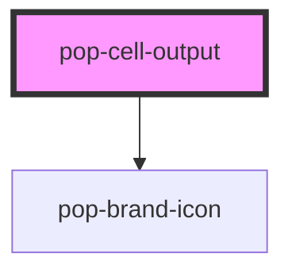

# pop-cell-output

<!-- Auto Generated Below -->

## Properties

| Property | Attribute | Description                                                            | Type                                       | Default     |
| -------- | --------- | ---------------------------------------------------------------------- | ------------------------------------------ | ----------- |
| `count`  | `count`   | Jupyter-style execution count. 0 → not yet run.                        | `number`                                   | `0`         |
| `items`  | `items`   | Ordered output entries; accepts a JSON string (attribute) or an array. | `CellItem[] \| string`                     | `[]`        |
| `ms`     | `ms`      | Wall-clock ms for the last run (footer hint).                          | `number`                                   | `undefined` |
| `status` | `status`  | Cell run status.                                                       | `"done" \| "error" \| "idle" \| "running"` | `'idle'`    |

## Dependencies

### Depends on

- [pop-brand-icon](../../atoms/brand-icon)

### Graph

----------------------------------------------

*Built with [StencilJS](https://stenciljs.com/)*
