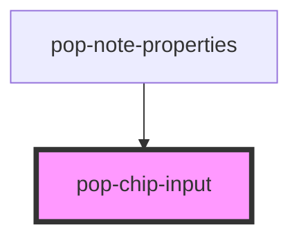

# pop-chip-input

<!-- Auto Generated Below -->

## Properties

| Property      | Attribute      | Description                                                                                                                                          | Type               | Default  |
| ------------- | -------------- | ---------------------------------------------------------------------------------------------------------------------------------------------------- | ------------------ | -------- |
| `allowCreate` | `allow-create` | Show the inline "＋ Create «text»" row when the draft matches no suggestion. Off by default so existing {id,label} / free-text callers are unchanged. | `boolean`          | `false`  |
| `placeholder` | `placeholder`  | Placeholder for the trailing text input.                                                                                                             | `string`           | `'Add…'` |
| `readonly`    | `readonly`     | Hide the trailing add-input (read-only mode).                                                                                                        | `boolean`          | `false`  |
| `strict`      | `strict`       | Reject values that don't match a suggestion id.                                                                                                      | `boolean`          | `false`  |
| `suggestions` | --             | Optional suggestions for autocomplete + chip label resolution.                                                                                       | `ChipSuggestion[]` | `[]`     |
| `value`       | --             | Current value array.                                                                                                                                 | `string[]`         | `[]`     |

## Events

| Event          | Description                                                                                                                                                                                                     | Type                              |
| -------------- | --------------------------------------------------------------------------------------------------------------------------------------------------------------------------------------------------------------- | --------------------------------- |
| `createChip`   | Emitted when the user picks the inline "Create «text»" row (the typed text matches no existing suggestion). The host persists a new chip/tag and adds its id to `value`. Only fires when `allowCreate` is true. | `CustomEvent<{ label: string; }>` |
| `valueChanged` |                                                                                                                                                                                                                 | `CustomEvent<string[]>`           |

## Methods

### `focusInput() => Promise<void>`

Imperatively focus the input.

#### Returns

Type: `Promise<void>`

## Dependencies

### Used by

 - [pop-note-properties](../../organisms/note-properties)

### Graph

----------------------------------------------

*Built with [StencilJS](https://stenciljs.com/)*
