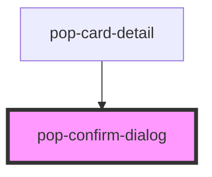

# pop-confirm-dialog

<!-- Auto Generated Below -->

## Properties

| Property       | Attribute       | Description | Type      | Default           |
| -------------- | --------------- | ----------- | --------- | ----------------- |
| `cancelLabel`  | `cancel-label`  |             | `string`  | `'Cancel'`        |
| `confirmLabel` | `confirm-label` |             | `string`  | `'Delete'`        |
| `confirmTitle` | `confirm-title` |             | `string`  | `'Confirm'`       |
| `danger`       | `danger`        |             | `boolean` | `true`            |
| `message`      | `message`       |             | `string`  | `'Are you sure?'` |

## Events

| Event        | Description | Type                |
| ------------ | ----------- | ------------------- |
| `popCancel`  |             | `CustomEvent<void>` |
| `popConfirm` |             | `CustomEvent<void>` |

## Methods

### `confirm() => Promise<boolean>`

#### Returns

Type: `Promise<boolean>`

## Dependencies

### Used by

 - [pop-card-detail](../../organisms/card-detail)

### Graph

----------------------------------------------

*Built with [StencilJS](https://stenciljs.com/)*
