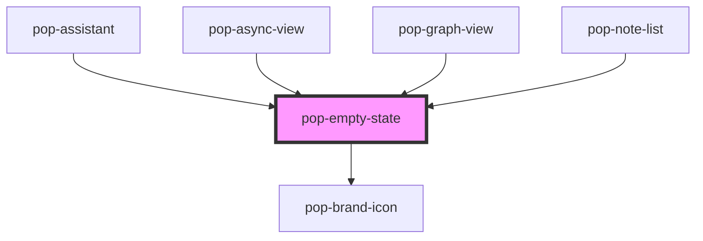

# pop-empty-state

<!-- Auto Generated Below -->

## Properties

| Property   | Attribute   | Description                                                                                                                                         | Type                 | Default     |
| ---------- | ----------- | --------------------------------------------------------------------------------------------------------------------------------------------------- | -------------------- | ----------- |
| `heading`  | `heading`   |                                                                                                                                                     | `string`             | `undefined` |
| `icon`     | `icon`      | Legacy: a literal glyph/emoji. Prefer `iconName`.                                                                                                   | `string`             | `undefined` |
| `iconName` | `icon-name` | A `pop-brand-icon` name (preferred — a themeable SVG). When set it renders the vector icon; falls back to the legacy `icon` glyph string otherwise. | `string`             | `undefined` |
| `message`  | `message`   |                                                                                                                                                     | `string`             | `undefined` |
| `size`     | `size`      |                                                                                                                                                     | `"full" \| "inline"` | `'inline'`  |

## Dependencies

### Used by

 - [pop-assistant](../../organisms/assistant)
 - [pop-async-view](../async-view)
 - [pop-graph-view](../../organisms/graph-view)
 - [pop-note-list](../../organisms/note-list)

### Depends on

- [pop-brand-icon](../../atoms/brand-icon)

### Graph

----------------------------------------------

*Built with [StencilJS](https://stenciljs.com/)*
