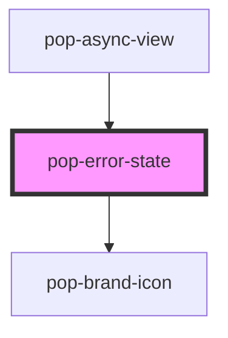

# pop-error-state

<!-- Auto Generated Below -->

## Overview

pop-error-state — the shared error primitive for the notes-app.

A centered warning illustration (themeable `pop-brand-icon`) + heading +
message, with an optional **Retry** button that emits `popRetry`. Pages that
hand-rolled ad-hoc error markup route through this so every failure looks the
same. Announced with `role="alert"`.

## Properties

| Property     | Attribute     | Description                                          | Type                 | Default                  |
| ------------ | ------------- | ---------------------------------------------------- | -------------------- | ------------------------ |
| `heading`    | `heading`     |                                                      | `string`             | `'Something went wrong'` |
| `iconName`   | `icon-name`   | `pop-brand-icon` name for the illustration.          | `string`             | `'warning'`              |
| `message`    | `message`     |                                                      | `string`             | `''`                     |
| `retryLabel` | `retry-label` | Retry button label.                                  | `string`             | `'Try again'`            |
| `retryable`  | `retryable`   | Show a Retry button (emits `popRetry`).              | `boolean`            | `false`                  |
| `size`       | `size`        | `inline` (compact) or `full` (centered, min-height). | `"full" \| "inline"` | `'inline'`               |

## Events

| Event      | Description | Type                |
| ---------- | ----------- | ------------------- |
| `popRetry` |             | `CustomEvent<void>` |

## Dependencies

### Used by

 - [pop-async-view](../async-view)

### Depends on

- [pop-brand-icon](../../atoms/brand-icon)

### Graph

----------------------------------------------

*Built with [StencilJS](https://stenciljs.com/)*
