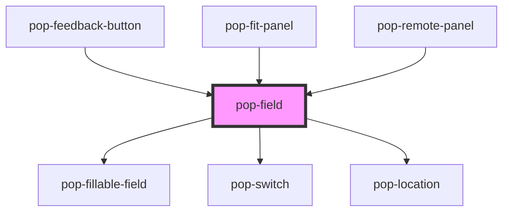

# pop-field

<!-- Auto Generated Below -->

## Overview

pop-field — ONE labeled form field: a `FieldSpec` → the right widget.

Type → widget:
  text, select → pop-fillable-field   number → native input (CLAMPED to min/max)
  date → native date input            boolean → pop-switch
  location → pop-location             depth / persist → composites (below)
  anything else → default-slot fallback (label/hint/required chrome kept,
                  slotted widget's `valueChange` re-emitted as pop-field's own)

Emits `valueChange` with `{ key, value }` for every edit.

Composites:
  depth   — value is `{ depth, maxSources }` (see DepthValue): the Quick/
            Standard/Deep/Custom slider + source-count box. Presets set
            `depth` and clear `maxSources`; Custom clears `depth` and drives
            `maxSources` (the host emits --depth / --max-sources from it).
  persist — value is 'none'|'note'|'index'|'both' computed from the two
            checkboxes (Save as note / Add to knowledge base).

Single-field only, by decision — schema-driven pop-form is deferred; hosts
keep their own form-assembly loop and render each field through this.

## Properties

| Property            | Attribute  | Description                                                                                    | Type        | Default     |
| ------------------- | ---------- | ---------------------------------------------------------------------------------------------- | ----------- | ----------- |
| `disabled`          | `disabled` |                                                                                                | `boolean`   | `false`     |
| `invalid`           | `invalid`  | Owner-driven inline "Required" feedback (shown under the widget).                              | `boolean`   | `false`     |
| `spec` _(required)_ | --         | The field spec (object — set as a property, not an attribute).                                 | `FieldSpec` | `undefined` |
| `value`             | --         | Current value. string for most types; boolean for `boolean`; `{depth,maxSources}` for `depth`. | `unknown`   | `undefined` |

## Events

| Event         | Description                                                                           | Type                                            |
| ------------- | ------------------------------------------------------------------------------------- | ----------------------------------------------- |
| `valueChange` | Emitted with `{ key, value }` on every edit (incl. re-emitted slot-fallback changes). | `CustomEvent<{ key: string; value: unknown; }>` |

## Dependencies

### Used by

 - [pop-feedback-button](../../organisms/feedback-button)
 - [pop-fit-panel](../../organisms/fit-panel)
 - [pop-remote-panel](../../organisms/remote-panel)

### Depends on

- [pop-fillable-field](../fillable-field)
- [pop-switch](../../atoms/switch)
- [pop-location](../../organisms/location)

### Graph

----------------------------------------------

*Built with [StencilJS](https://stenciljs.com/)*
