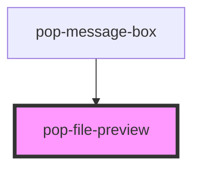

# pop-file-preview

<!-- Auto Generated Below -->

## Properties

| Property | Attribute | Description                             | Type     | Default |
| -------- | --------- | --------------------------------------- | -------- | ------- |
| `files`  | `files`   | JSON array of {name, url, type} objects | `string` | `'[]'`  |

## Events

| Event           | Description                                                  | Type                  |
| --------------- | ------------------------------------------------------------ | --------------------- |
| `popFileRemove` | Emitted when a file remove button is clicked, with the index | `CustomEvent<number>` |

## Dependencies

### Used by

 - [pop-message-box](../../organisms/message-box)

### Graph

----------------------------------------------

*Built with [StencilJS](https://stenciljs.com/)*
