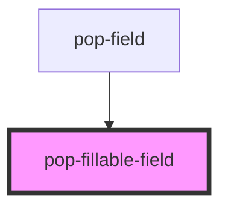

# pop-fillable-field

<!-- Auto Generated Below -->

## Overview

pop-fillable-field — a labelled form control with a right-aligned "auto-fill"
toggle, styled like a browser password-reveal field.

The toggle flips a field between two modes:
  - **baked**      (flash-off icon) — the value is fixed into whatever is
                   being built (e.g. an NFC tag).
  - **ask-on-tap** (flash icon)     — the value is collected later (when the
                   tag is tapped). A typed value still acts as the default.

The input stays editable in both modes; the icon only reflects/sets the mode.

Use the built-in text input:
  <pop-fillable-field
    label="Title"
    value={title}
    placeholder="e.g. Microwave"
    askOnTap={titleAsk}
    onValueChange={e => (title = e.detail)}
    onAskChange={e => (titleAsk = e.detail)}
  />

…or slot a custom control (<select>, value+unit row, etc.) — set `useSlot`:
  <pop-fillable-field label="Priority" askOnTap={ask} useSlot onAskChange={…}>
    <select>…</select>
  </pop-fillable-field>

## Properties

| Property             | Attribute     | Description                                                                                                             | Type                                  | Default     |
| -------------------- | ------------- | ----------------------------------------------------------------------------------------------------------------------- | ------------------------------------- | ----------- |
| `askOnTap`           | `ask-on-tap`  | Whether the field auto-fills on tap (true) or is baked (false).                                                         | `boolean`                             | `false`     |
| `askable`            | `askable`     | Whether to show the auto-fill toggle at all.                                                                            | `boolean`                             | `true`      |
| `hint`               | `hint`        | Optional secondary text shown next to the label (e.g. a unit hint).                                                     | `string`                              | `undefined` |
| `inputType`          | `input-type`  | Input type for the built-in text input (text, number, datetime-local…).                                                 | `string`                              | `'text'`    |
| `label` _(required)_ | `label`       | Field label shown above the control.                                                                                    | `string`                              | `undefined` |
| `options`            | --            | When set, render a <select> of these options instead of a text input. The selected option is whichever matches `value`. | `{ value: string; label: string; }[]` | `undefined` |
| `placeholder`        | `placeholder` | Placeholder for the built-in text input.                                                                                | `string`                              | `undefined` |
| `useSlot`            | `use-slot`    | Render a slotted control instead of the built-in text input.                                                            | `boolean`                             | `false`     |
| `value`              | `value`       | Value for the built-in text input (ignored when `useSlot` is set).                                                      | `string`                              | `''`        |

## Events

| Event         | Description                                                          | Type                   |
| ------------- | -------------------------------------------------------------------- | ---------------------- |
| `askChange`   | Emitted when the auto-fill toggle flips. Detail is the new askOnTap. | `CustomEvent<boolean>` |
| `valueChange` | Emitted when the built-in input value changes.                       | `CustomEvent<string>`  |

## Dependencies

### Used by

 - [pop-field](../field)

### Graph

----------------------------------------------

*Built with [StencilJS](https://stenciljs.com/)*
