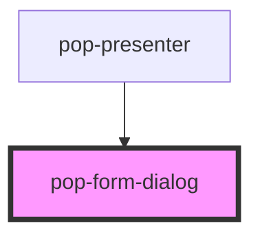

# pop-form-dialog

<!-- Auto Generated Below -->

## Properties

| Property      | Attribute      | Description                                                                                                                                                                                                                                                                                                                                                                                                                                                                                                                                                                                            | Type      | Default     |
| ------------- | -------------- | ------------------------------------------------------------------------------------------------------------------------------------------------------------------------------------------------------------------------------------------------------------------------------------------------------------------------------------------------------------------------------------------------------------------------------------------------------------------------------------------------------------------------------------------------------------------------------------------------------ | --------- | ----------- |
| `cancelLabel` | `cancel-label` |                                                                                                                                                                                                                                                                                                                                                                                                                                                                                                                                                                                                        | `string`  | `'Cancel'`  |
| `description` | `description`  |                                                                                                                                                                                                                                                                                                                                                                                                                                                                                                                                                                                                        | `string`  | `undefined` |
| `dialogTitle` | `dialog-title` |                                                                                                                                                                                                                                                                                                                                                                                                                                                                                                                                                                                                        | `string`  | `undefined` |
| `headerBar`   | `header-bar`   | Opt into a slotted HEADER BAR: a single flex row laid out as   `[ slot="header" …flex-grows… ] [ slot="header-actions" ] [ × close ]` so the consumer supplies its OWN title + right-side control (a list-select, a room switcher, …) INLINE with the close/action buttons — nothing overlaps the ×, and the consumer's control can't be clipped in the top-right corner.  When false (the default) the dialog keeps its legacy chrome: the absolutely positioned round × plus an optional `dialogTitle` heading. Existing consumers that pass `dialogTitle` are unaffected — this is purely additive. | `boolean` | `false`     |
| `hideFooter`  | `hide-footer`  | Hide the footer (Cancel/Submit) entirely — for dialogs that are dismissed by the × / backdrop and have no explicit confirm action (e.g. the Weather panel).                                                                                                                                                                                                                                                                                                                                                                                                                                            | `boolean` | `false`     |
| `open`        | `open`         |                                                                                                                                                                                                                                                                                                                                                                                                                                                                                                                                                                                                        | `boolean` | `false`     |
| `submitLabel` | `submit-label` |                                                                                                                                                                                                                                                                                                                                                                                                                                                                                                                                                                                                        | `string`  | `'Save'`    |

## Events

| Event       | Description | Type                |
| ----------- | ----------- | ------------------- |
| `popClose`  |             | `CustomEvent<void>` |
| `popSubmit` |             | `CustomEvent<void>` |

## Dependencies

### Used by

 - [pop-presenter](../../organisms/presenter)

### Graph

----------------------------------------------

*Built with [StencilJS](https://stenciljs.com/)*
