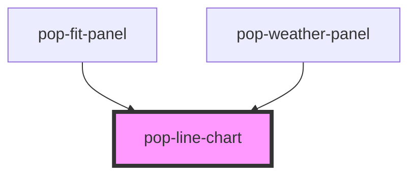

# pop-line-chart

<!-- Auto Generated Below -->

## Overview

pop-line-chart — a self-contained, dependency-free inline-SVG chart for small
multi-series data (temp / humidity / precipitation), with an optional second
y-axis (e.g. % vs °F), shaded bands (night), x-axis markers (sunrise/sunset),
and a compact legend. Responsive via viewBox; theme via the series colors you
pass. Reusable across panels — pass different series/scope.

Props accept either real arrays/objects (Stencil prop binding) OR JSON strings
(so it works from plain HTML / Storybook templates too).

## Properties

| Property          | Attribute           | Description                                                                                                                                                                                                                                                                                                                                                                                                                                                  | Type                         | Default        |
| ----------------- | ------------------- | ------------------------------------------------------------------------------------------------------------------------------------------------------------------------------------------------------------------------------------------------------------------------------------------------------------------------------------------------------------------------------------------------------------------------------------------------------------ | ---------------------------- | -------------- |
| `bands`           | `bands`             | Shaded x-ranges (night) as index bounds.                                                                                                                                                                                                                                                                                                                                                                                                                     | `ChartBand[] \| string`      | `[]`           |
| `chartTitle`      | `chart-title`       | Accessible title.                                                                                                                                                                                                                                                                                                                                                                                                                                            | `string`                     | `'Chart'`      |
| `leftUnit`        | `left-unit`         | Unit suffix for the left axis (e.g. "°").                                                                                                                                                                                                                                                                                                                                                                                                                    | `string`                     | `''`           |
| `markers`         | `markers`           | Vertical markers (sunrise/sunset) at data indices.                                                                                                                                                                                                                                                                                                                                                                                                           | `ChartMarker[] \| string`    | `[]`           |
| `orientation`     | `orientation`       | Layout orientation:  - 'horizontal' (default): index axis runs left→right, value axis bottom→top.  - 'vertical': index axis runs top→bottom (one cell per data point, fixed    `rowHeight`), value axis left→right. Built to sit beside an external list    of the SAME row height so row i lines up with point i. The SVG's height is    count*rowHeight; place it in a non-scaling, slim column and let the parent    scroll it in lockstep with the list. | `"horizontal" \| "vertical"` | `'horizontal'` |
| `rangeBands`      | `range-bands`       | Shaded y-VALUE ranges (e.g. a glucose normal band). Horizontal mode only.                                                                                                                                                                                                                                                                                                                                                                                    | `ChartRangeBand[] \| string` | `[]`           |
| `refLines`        | `ref-lines`         | Horizontal reference lines at y-values (goal lines). Horizontal mode only.                                                                                                                                                                                                                                                                                                                                                                                   | `ChartRefLine[] \| string`   | `[]`           |
| `rightUnit`       | `right-unit`        | Unit suffix for the right axis (e.g. "%").                                                                                                                                                                                                                                                                                                                                                                                                                   | `string`                     | `''`           |
| `rowHeight`       | `row-height`        | Vertical mode: per-row height in px (match the list's row pitch).                                                                                                                                                                                                                                                                                                                                                                                            | `number`                     | `44`           |
| `series`          | `series`            | Series to plot. Area series (kind:'area') render filled-from-baseline.                                                                                                                                                                                                                                                                                                                                                                                       | `ChartSeries[] \| string`    | `[]`           |
| `showValueLabels` | `show-value-labels` | Vertical mode: render per-point VALUE LABELS + point dots so the temp / humidity readings are legible on their own (not just a line smear). The first LINE series on the LEFT axis is labelled in the left gutter (°), the first on the RIGHT axis in the right gutter (%). Additive — off by default.                                                                                                                                                       | `boolean`                    | `false`        |
| `vbWidth`         | `vb-width`          | Vertical mode: the viewBox WIDTH in px. Because the vertical chart uses `preserveAspectRatio="none"`, the host should render the SVG at THIS same CSS width (e.g. `flex: 0 0 150px`) so the x-axis is 1:1 and value-label text is crisp (not horizontally stretched). Default 80 keeps the pre-existing slim strip behaviour for callers that don't opt into labels.                                                                                         | `number`                     | `80`           |
| `xLabels`         | `x-labels`          | X-axis tick labels (subset shown to avoid crowding).                                                                                                                                                                                                                                                                                                                                                                                                         | `string \| string[]`         | `[]`           |

## Dependencies

### Used by

 - [pop-fit-panel](../../organisms/fit-panel)
 - [pop-weather-panel](../../organisms/weather-panel)

### Graph

----------------------------------------------

*Built with [StencilJS](https://stenciljs.com/)*
