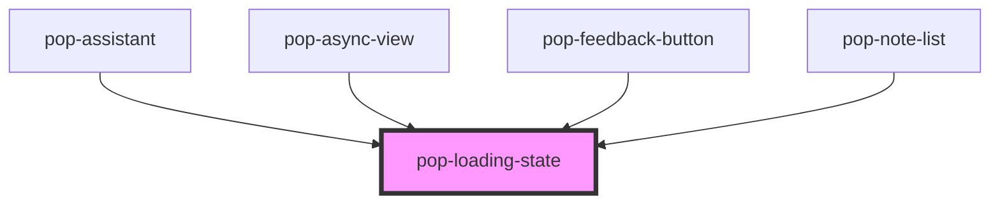

# pop-loading-state

<!-- Auto Generated Below -->

## Overview

pop-loading-state — the shared loading primitive for the notes-app.

Two variants:
 - `variant="spinner"` (default): a centered spinner + optional label, for
   one-shot async surfaces (editor load, ask streaming, graph build).
 - `variant="card-skeleton"`: a stack of **card-shaped** skeletons that mirror
   the note-card layout (title bar + snippet lines + meta row) so the loading
   state has the same silhouette as the content that replaces it — not a
   generic grey rectangle. `count` sets how many; `grid` tiles them.

Always announces itself: `role="status"` + `aria-busy` so assistive tech
knows the region is loading.

## Properties

| Property    | Attribute    | Description                                                      | Type                           | Default      |
| ----------- | ------------ | ---------------------------------------------------------------- | ------------------------------ | ------------ |
| `count`     | `count`      | Number of skeleton cards (card-skeleton variant).                | `number`                       | `5`          |
| `grid`      | `grid`       | Tile the skeletons in a gallery grid instead of a single column. | `boolean`                      | `false`      |
| `label`     | `label`      | Visible / announced label.                                       | `string`                       | `'Loading…'` |
| `showLabel` | `show-label` | Show the label text next to the spinner (spinner variant).       | `boolean`                      | `false`      |
| `variant`   | `variant`    | `spinner` (default) or `card-skeleton`.                          | `"card-skeleton" \| "spinner"` | `'spinner'`  |

## Dependencies

### Used by

 - [pop-assistant](../../organisms/assistant)
 - [pop-async-view](../async-view)
 - [pop-feedback-button](../../organisms/feedback-button)
 - [pop-note-list](../../organisms/note-list)

### Graph

----------------------------------------------

*Built with [StencilJS](https://stenciljs.com/)*
