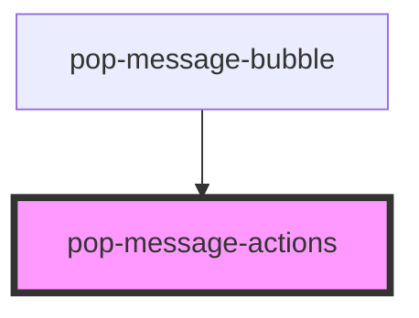

# pop-message-actions

<!-- Auto Generated Below -->

## Properties

| Property      | Attribute      | Description | Type      | Default |
| ------------- | -------------- | ----------- | --------- | ------- |
| `isAdmin`     | `is-admin`     |             | `boolean` | `false` |
| `isOwn`       | `is-own`       |             | `boolean` | `false` |
| `isThread`    | `is-thread`    |             | `boolean` | `false` |
| `messageId`   | `message-id`   |             | `string`  | `''`    |
| `threadCount` | `thread-count` |             | `number`  | `0`     |

## Events

| Event                | Description | Type                           |
| -------------------- | ----------- | ------------------------------ |
| `popDeleteRequested` |             | `CustomEvent<string>`          |
| `popEditRequested`   |             | `CustomEvent<string>`          |
| `popThreadOpened`    |             | `CustomEvent<{ id: string; }>` |

## Dependencies

### Used by

 - [pop-message-bubble](../../organisms/message-bubble)

### Graph

----------------------------------------------

*Built with [StencilJS](https://stenciljs.com/)*
