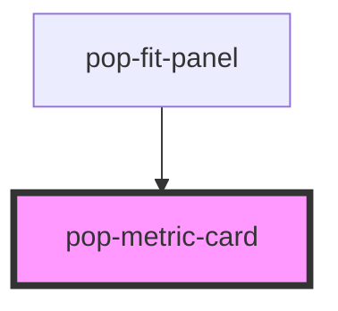

# pop-metric-card

<!-- Auto Generated Below -->

## Overview

pop-metric-card — a reusable stat tile (molecule).

A compact card showing an emoji/glyph, a title, a big value and an optional
sub-line. When `loggable`, the card doubles as a LOG ENTRY POINT: it grows a
subtle "+" badge (top-right) that turns brand-blue on hover/focus and rotates
to a "✕" when `active`, plus a "Tap to log" hint that slides up on hover. The
whole card is a button that emits `popCardTap` with its `cardKey` — the host
decides what to do (e.g. open a log form, drill into a detail sheet).

Intentionally presentation-only and domain-agnostic: it knows nothing about
Fit, Popcoin or Inventory — the host hands it a glyph + strings and listens
for taps. Reuse it anywhere a tappable stat tile is wanted.

## Properties

| Property   | Attribute  | Description                                                                                                                | Type      | Default |
| ---------- | ---------- | -------------------------------------------------------------------------------------------------------------------------- | --------- | ------- |
| `active`   | `active`   | Highlighted/pressed state — e.g. the card whose log form is open, or the one just logged. Rotates the "+" badge to a "✕".  | `boolean` | `false` |
| `cardKey`  | `card-key` | Identity emitted with `popCardTap` so a host with many cards knows which one was tapped. Defaults to the label when unset. | `string`  | `''`    |
| `glyph`    | `glyph`    | The emoji / glyph shown before the title (e.g. "⚖️"). Kept as a literal glyph by design — this is NOT a pop-icon slot.     | `string`  | `''`    |
| `label`    | `label`    | The card title (e.g. "Weight").                                                                                            | `string`  | `''`    |
| `loggable` | `loggable` | Shows the tap-to-log affordance (the "+" badge + "Tap to log" hint). Off → the card is a plain (still tappable) stat tile. | `boolean` | `false` |
| `sub`      | `sub`      | Optional sub-line under the value (e.g. "Jul 15" or "of 2,000 goal").                                                      | `string`  | `''`    |
| `value`    | `value`    | The big value (e.g. "150.7 lbs"). Rendered on one line where it fits.                                                      | `string`  | `''`    |

## Events

| Event        | Description                                                                | Type                  |
| ------------ | -------------------------------------------------------------------------- | --------------------- |
| `popCardTap` | Fires when the card is tapped — detail is the card's `cardKey` (or label). | `CustomEvent<string>` |

## Dependencies

### Used by

 - [pop-fit-panel](../../organisms/fit-panel)

### Graph

----------------------------------------------

*Built with [StencilJS](https://stenciljs.com/)*
