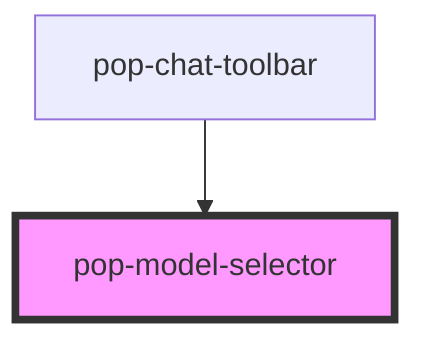

# pop-model-selector

<!-- Auto Generated Below -->

## Properties

| Property        | Attribute        | Description                    | Type     | Default  |
| --------------- | ---------------- | ------------------------------ | -------- | -------- |
| `models`        | `models`         | JSON string of ModelGroup[]    | `string` | `'[]'`   |
| `selectedMode`  | `selected-mode`  | Currently selected mode        | `string` | `'chat'` |
| `selectedModel` | `selected-model` | Currently selected model value | `string` | `''`     |

## Events

| Event             | Description | Type                  |
| ----------------- | ----------- | --------------------- |
| `popModeChanged`  |             | `CustomEvent<string>` |
| `popModelChanged` |             | `CustomEvent<string>` |

## Dependencies

### Used by

 - [pop-chat-toolbar](../../organisms/chat-toolbar)

### Graph

----------------------------------------------

*Built with [StencilJS](https://stenciljs.com/)*
