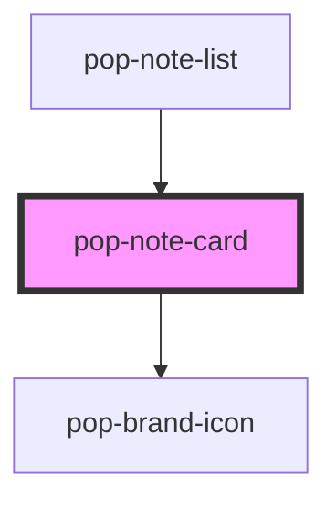

# pop-note-card

<!-- Auto Generated Below -->

## Properties

| Property            | Attribute  | Description                                                                                                                                                                                                                                              | Type                            | Default     |
| ------------------- | ---------- | -------------------------------------------------------------------------------------------------------------------------------------------------------------------------------------------------------------------------------------------------------- | ------------------------------- | ----------- |
| `actions`           | `actions`  | Inline action affordance rendered beneath the card.  - `'none'`  (default): no actions (Home/search/grid).  - `'inbox'`: triage variant → source badge + [🔗 link] [✎ open] [✓ keep] [🗑].  - `'trash'`: Trash variant → [↩ Restore] [✕ Delete forever]. | `"inbox" \| "none" \| "trash"`  | `'none'`    |
| `layout`            | `layout`   | Layout: a full-width list row, a gallery grid tile, or compact result chip.                                                                                                                                                                              | `"compact" \| "grid" \| "list"` | `'list'`    |
| `note` _(required)_ | --         | The note to preview (set as a property).                                                                                                                                                                                                                 | `NoteCardData`                  | `undefined` |
| `selected`          | `selected` | Highlighted when this is the selected note in the split-pane.                                                                                                                                                                                            | `boolean`                       | `false`     |
| `snippet`           | `snippet`  | Snippet/excerpt text. The page supplies it from the note's first blocks.                                                                                                                                                                                 | `string`                        | `''`        |

## Events

| Event         | Description                                                            | Type                                            |
| ------------- | ---------------------------------------------------------------------- | ----------------------------------------------- |
| `noteLink`    | Inbox: link this note to another (the page opens its link picker).     | `CustomEvent<{ id: string; }>`                  |
| `notePin`     | Fired when the pin toggle is pressed.                                  | `CustomEvent<{ id: string; pinned: boolean; }>` |
| `notePurge`   | Trash: delete forever (permanent purge; the page confirms first).      | `CustomEvent<{ id: string; }>`                  |
| `noteRestore` | Trash: restore (clears deletedAt).                                     | `CustomEvent<{ id: string; }>`                  |
| `noteSelect`  | Fired when the card is activated (click / Enter / Space).              | `CustomEvent<{ id: string; }>`                  |
| `noteTrash`   | Soft-delete → Trash (Inbox 🗑).                                        | `CustomEvent<{ id: string; }>`                  |
| `noteTriage`  | Inbox triage: "keep" → the page sets triagedAt so it leaves the queue. | `CustomEvent<{ id: string; }>`                  |

## Dependencies

### Used by

 - [pop-note-list](../../organisms/note-list)

### Depends on

- [pop-brand-icon](../../atoms/brand-icon)

### Graph

----------------------------------------------

*Built with [StencilJS](https://stenciljs.com/)*
