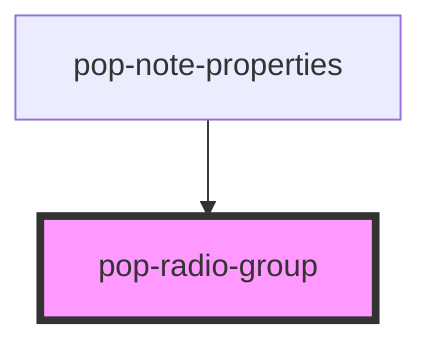

# pop-radio-group

<!-- Auto Generated Below -->

## Properties

| Property    | Attribute    | Description | Type            | Default |
| ----------- | ------------ | ----------- | --------------- | ------- |
| `ariaLabel` | `aria-label` |             | `string`        | `''`    |
| `disabled`  | `disabled`   |             | `boolean`       | `false` |
| `options`   | --           |             | `RadioOption[]` | `[]`    |
| `value`     | `value`      |             | `string`        | `''`    |

## Events

| Event          | Description | Type                  |
| -------------- | ----------- | --------------------- |
| `valueChanged` |             | `CustomEvent<string>` |

## Dependencies

### Used by

 - [pop-note-properties](../../organisms/note-properties)

### Graph

----------------------------------------------

*Built with [StencilJS](https://stenciljs.com/)*
