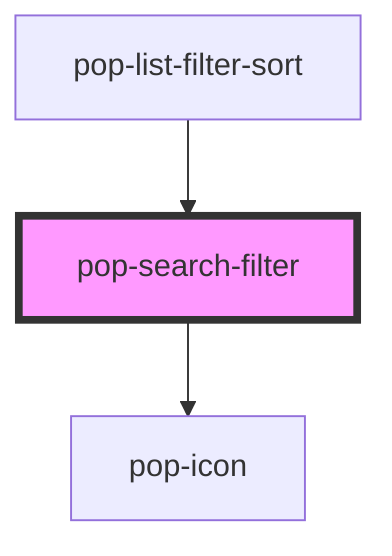

# pop-search-filter

<!-- Auto Generated Below -->

## Overview

`pop-search-filter` — a search input with the funnel FILTER BUTTON baked into
the field's right edge (and a leading search glyph on the left), popover
included.

The hub's dialogs (photos/images, tasks, inventory, calendar) each hand-roll
this exact search + funnel-filter idiom; this molecule is the shared piece.
Expected adopters: hub-images (photos), hub-tasks, hub-inventory, and any
future list dialog — usually via the `pop-list-filter-sort` organism.

CONTROLLED for filters: the host passes `filters` (a JSON array of
{key,label,kind,options,value} group descriptors) and reacts to
`filterChange` / `clearFilters`. The search text is a mutable `value` prop;
`searchChange` is debounced (`debounce` ms).

The funnel trigger shows an active-filter DOT when any group's value !==
its `default` (`''` when omitted — the calendar/tasks idiom). Popover
dismisses on backdrop click + Escape. `filters` parsing to an EMPTY array →
the funnel is not rendered at all (search-only mode).

CUSTOM INPUT (`input` slot): slot a host-owned search widget (e.g. hub-tasks'
pop-mention-input) with `slot="input"` and it takes the built-in input's
place while the funnel + popover + active dot + Clear all chrome is kept
(the lead search glyph is dropped — the widget brings its own affordances,
and the funnel rides the row as a static field-height sibling since it can't
safely inset into an arbitrary widget). In slot mode the HOST owns the
widget's value/events; `searchChange` fires only from the built-in input.
The slot element is ALWAYS rendered (scoped-slot rule: a conditionally added
slot never picks up late-mounted content); detection is a light-DOM
`[slot="input"]` query re-checked after every render.

## Properties

| Property      | Attribute     | Description                                                                  | Type      | Default     |
| ------------- | ------------- | ---------------------------------------------------------------------------- | --------- | ----------- |
| `debounce`    | `debounce`    | Debounce (ms) for `searchChange`. 0 → emit synchronously.                    | `number`  | `150`       |
| `filters`     | `filters`     | JSON array of filter group descriptors (see SearchFilterGroup).              | `string`  | `'[]'`      |
| `placeholder` | `placeholder` | Placeholder for the search input.                                            | `string`  | `'Search…'` |
| `showClear`   | `show-clear`  | Show a "Clear all" affordance in the popover when any filter is non-default. | `boolean` | `true`      |
| `value`       | `value`       | Current search text (mutable — reflects what's in the field).                | `string`  | `''`        |

## Events

| Event          | Description                             | Type                                           |
| -------------- | --------------------------------------- | ---------------------------------------------- |
| `clearFilters` | The "Clear all" affordance was pressed. | `CustomEvent<void>`                            |
| `filterChange` | A filter group's value changed.         | `CustomEvent<{ key: string; value: string; }>` |
| `searchChange` | Debounced search text.                  | `CustomEvent<string>`                          |

## Dependencies

### Used by

 - [pop-list-filter-sort](../../organisms/list-filter-sort)

### Depends on

- [pop-icon](../../atoms/icon)

### Graph

----------------------------------------------

*Built with [StencilJS](https://stenciljs.com/)*
