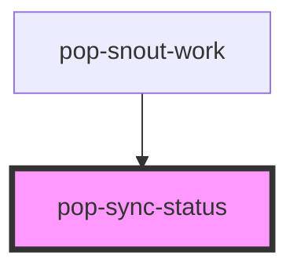

# pop-sync-status

<!-- Auto Generated Below -->

## Overview

pop-sync-status — a compact "Last synced <relative>" row + a refresh button,
for cache-first / stale-while-revalidate data panels. The relative label
auto-updates on an internal ~30s timer; the refresh icon spins while loading.

Reusable: any panel that caches data can drop this in, pass its last-fetch
`syncedAt` + `loading`, and listen for `popRefresh` to force a revalidate.

## Properties

| Property    | Attribute    | Description                                                                                                                                                                                                                                                                                                                                                                                                                           | Type               | Default     |
| ----------- | ------------ | ------------------------------------------------------------------------------------------------------------------------------------------------------------------------------------------------------------------------------------------------------------------------------------------------------------------------------------------------------------------------------------------------------------------------------------- | ------------------ | ----------- |
| `bare`      | `bare`       | Bare/inline variant: one chrome-less button — relative time as the label + the refresh icon, no background. For placing in a panel header top-right.                                                                                                                                                                                                                                                                                  | `boolean`          | `false`     |
| `labelOnly` | `label-only` | Render the STALENESS LABEL ONLY — no refresh button, nothing clickable.  For surfaces that keep "Nm ago" visible in a header but have moved the manual refresh action somewhere else (the bucket-hub panel contract puts it in the panel's `…` overflow menu). Splitting them keeps ONE component owning the ~30s auto-updating relative label, instead of a second implementation of that timer next to a standalone refresh button. | `boolean`          | `false`     |
| `loading`   | `loading`    | True while a refresh is in flight (spins the icon, disables the button).                                                                                                                                                                                                                                                                                                                                                              | `boolean`          | `false`     |
| `syncedAt`  | `synced-at`  | Last successful fetch time — epoch ms or an ISO string.                                                                                                                                                                                                                                                                                                                                                                               | `number \| string` | `undefined` |

## Events

| Event        | Description                                             | Type                |
| ------------ | ------------------------------------------------------- | ------------------- |
| `popRefresh` | popRefresh fires when the user taps the refresh button. | `CustomEvent<void>` |

## Dependencies

### Used by

 - [pop-snout-work](../../organisms/snout-work)

### Graph

----------------------------------------------

*Built with [StencilJS](https://stenciljs.com/)*
