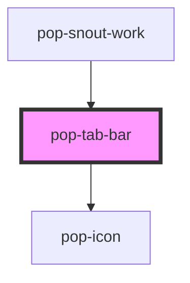

# pop-tab-bar

<!-- Auto Generated Below -->

## Overview

`pop-tab-bar` — the shared tab row with optional per-tab count bubbles and
icons.

COMPACT variant (`compact`): when the bar's own width falls under 480px
(a container query — panel width, not viewport), inactive tabs collapse to
icon + count with the label visually hidden; the ACTIVE tab keeps its label.
This keeps five tabs visible on a phone without horizontal scroll. Tabs
without an `icon` keep their label (there'd be nothing left to show).
Browsers without container-query support just keep the full labels.

## Properties

| Property     | Attribute    | Description                                                                                         | Type      | Default     |
| ------------ | ------------ | --------------------------------------------------------------------------------------------------- | --------- | ----------- |
| `activeTab`  | `active-tab` |                                                                                                     | `string`  | `undefined` |
| `compact`    | `compact`    | Collapse inactive tabs to icon + count when the bar is narrower than 480px (needs per-tab `icon`s). | `boolean` | `false`     |
| `scrollable` | `scrollable` |                                                                                                     | `boolean` | `false`     |
| `tabs`       | `tabs`       |                                                                                                     | `string`  | `'[]'`      |

## Events

| Event          | Description | Type                              |
| -------------- | ----------- | --------------------------------- |
| `popTabChange` |             | `CustomEvent<{ value: string; }>` |

## Dependencies

### Used by

 - [pop-snout-work](../../organisms/snout-work)

### Depends on

- [pop-icon](../../atoms/icon)

### Graph

----------------------------------------------

*Built with [StencilJS](https://stenciljs.com/)*
