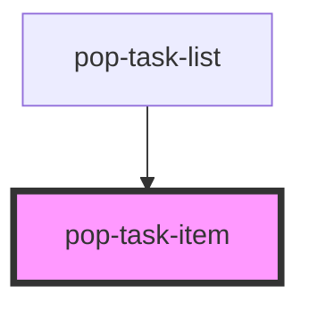

# pop-task-item

<!-- Auto Generated Below -->

## Properties

| Property        | Attribute         | Description                                                                                                                                                                                                                                                                                      | Type      | Default    |
| --------------- | ----------------- | ------------------------------------------------------------------------------------------------------------------------------------------------------------------------------------------------------------------------------------------------------------------------------------------------ | --------- | ---------- |
| `assignedTo`    | `assigned-to`     | JSON stringified array of user UIDs                                                                                                                                                                                                                                                              | `string`  | `'[]'`     |
| `checkable`     | `checkable`       | Whether the completion checkbox can be toggled. Defaults to true so a list row stays `readonly` (title locked) yet still lets you tap to complete. Set false for a fully static render (e.g. read-only editor).                                                                                  | `boolean` | `true`     |
| `checked`       | `checked`         | Whether the task is checked (derived from status === 'done')                                                                                                                                                                                                                                     | `boolean` | `false`    |
| `currentUserId` | `current-user-id` | The logged-in user's id. Their own avatar is hidden (you don't need to see yourself on every task) — the assignee avatar only shows OTHER people.                                                                                                                                                | `string`  | `''`       |
| `dragHandle`    | `drag-handle`     | Whether to render the right-edge drag handle. The parent list gates this so handles only appear when a drag actually does something — i.e. when a grouping is active (drag-to-regroup) or the sort is Manual (drag-to-reorder). Defaults to true so standalone/legacy consumers keep the handle. | `boolean` | `true`     |
| `dueDate`       | `due-date`        | ISO date string (YYYY-MM-DD)                                                                                                                                                                                                                                                                     | `string`  | `null`     |
| `hideAssignee`  | `hide-assignee`   | Suppress the assignee avatar+name chip. Useful when the surrounding list is already grouped by person (e.g. the tasks-app Family view), where a per-row assignee chip would be redundant.                                                                                                        | `boolean` | `false`    |
| `priority`      | `priority`        | Priority: urgent, high, medium, low                                                                                                                                                                                                                                                              | `string`  | `'medium'` |
| `questLabel`    | `quest-label`     | Optional quest title — rendered as a small chip so you can see which quest a task belongs to (empty = no chip).                                                                                                                                                                                  | `string`  | `''`       |
| `readonly`      | `readonly`        | If true, disables title editing (contenteditable / long-press / dblclick). Does NOT disable the completion checkbox — see `checkable`.                                                                                                                                                           | `boolean` | `false`    |
| `reminderAt`    | `reminder-at`     | ISO timestamp — fire time of a reminder/timer. Shown as a time pill (⏰) when the task has no due date (a one-off transient nudge).                                                                                                                                                               | `string`  | `null`     |
| `status`        | `status`          | Task status                                                                                                                                                                                                                                                                                      | `string`  | `'open'`   |
| `tags`          | `tags`            | JSON stringified array of tag strings — rendered as `#tag` chips in the meta row (empty array = no chips).                                                                                                                                                                                       | `string`  | `'[]'`     |
| `taskId`        | `task-id`         | Firestore task document ID                                                                                                                                                                                                                                                                       | `string`  | `''`       |
| `taskTitle`     | `task-title`      | Task title text                                                                                                                                                                                                                                                                                  | `string`  | `''`       |
| `threadLabel`   | `thread-label`    | Presentational thread label — a teal chip shown when a task is linked to a Bucket-Bot hub thread. Empty (default) hides it. Phase-1 hook only: the Share-to-Thread phase will populate this from the linked-thread field.                                                                        | `string`  | `''`       |
| `users`         | `users`           | JSON stringified array of { id, displayName, photoURL } for avatar rendering                                                                                                                                                                                                                     | `string`  | `'[]'`     |

## Events

| Event                | Description                                                                                                                                                                         | Type                                                                                    |
| -------------------- | ----------------------------------------------------------------------------------------------------------------------------------------------------------------------------------- | --------------------------------------------------------------------------------------- |
| `taskChanged`        | A task property was changed                                                                                                                                                         | `CustomEvent<{ taskId: string; field: string; value: any; }>`                           |
| `taskChecked`        | Checkbox was toggled                                                                                                                                                                | `CustomEvent<{ taskId: string; checked: boolean; }>`                                    |
| `taskDeleted`        | Task was deleted                                                                                                                                                                    | `CustomEvent<{ taskId: string; }>`                                                      |
| `taskDragHandleDown` | The drag handle was pressed — the parent list starts a pointer drag. The pointer info lets the list build a ghost + track the move without the row itself owning any drag geometry. | `CustomEvent<{ taskId: string; pointerId: number; clientX: number; clientY: number; }>` |

## Dependencies

### Used by

 - [pop-task-list](../task-list)

### Graph

----------------------------------------------

*Built with [StencilJS](https://stenciljs.com/)*
