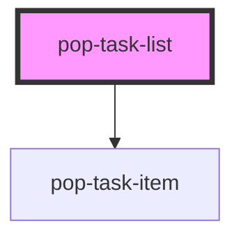

# pop-task-list

<!-- Auto Generated Below -->

## Properties

| Property                | Attribute                 | Description                                                                                                                                                                                                                                                                                     | Type                        | Default                            |
| ----------------------- | ------------------------- | ----------------------------------------------------------------------------------------------------------------------------------------------------------------------------------------------------------------------------------------------------------------------------------------------- | --------------------------- | ---------------------------------- |
| `anchor`                | `anchor`                  | Anchor for timeline scroll: 'today' \| 'last-completed' \| ISO date.                                                                                                                                                                                                                            | `string`                    | `'today'`                          |
| `currentUserId`         | `current-user-id`         | Logged-in user's id — forwarded so a task assigned only to you (or unassigned) shows no avatar.                                                                                                                                                                                                 | `string`                    | `''`                               |
| `defaultHiddenStatuses` | `default-hidden-statuses` | Statuses hidden by default in timeline mode (still surface in archive).                                                                                                                                                                                                                         | `string`                    | `'["done","cancelled","skipped"]'` |
| `filter`                | `filter`                  | JSON stringified filter object: { status?, assignee? }                                                                                                                                                                                                                                          | `string`                    | `'{}'`                             |
| `floorPlan`             | `floor-plan`              | JSON stringified FloorPlan (floorplan-core). Provides the canonical room list + aliases so a space's free-text `room` can be resolved when it has no stamped `roomId`.                                                                                                                          | `string`                    | `'null'`                           |
| `groupBy`               | `group-by`                | Grouping mode for the timeline: 'date' (date-bucketed, default), 'quest', 'location', 'status', 'priority', or 'none' (a true flat, ungrouped, sorted list with no date dividers). An unspecified value keeps the date timeline.                                                                | `string`                    | `'date'`                           |
| `hideAssignee`          | `hide-assignee`           | Suppress the per-row assignee chip on every item — set when the list is already grouped by person (e.g. the tasks-app Family view) so the chip isn't redundant. Forwarded to each pop-task-item.                                                                                                | `boolean`                   | `false`                            |
| `loadFuture`            | --                        | Lazy-loader for future tasks (called when user scrolls past last month bucket).                                                                                                                                                                                                                 | `() => Promise<TaskData[]>` | `undefined`                        |
| `loadPast`              | --                        | Lazy-loader for older tasks (called when user scrolls past archive).                                                                                                                                                                                                                            | `() => Promise<TaskData[]>` | `undefined`                        |
| `manualOrder`           | `manual-order`            | JSON stringified array of task ids defining the Manual sort order (used only when `sortBy === 'manual'`). Tasks are sorted by their index in this list; ids absent from it fall to the end (stable). The host owns this order (persisted per-device) and updates it on a `taskReordered` event. | `string`                    | `'[]'`                             |
| `mode`                  | `mode`                    | Display mode: `flat` (default, legacy) or `timeline` (date-bucketed).                                                                                                                                                                                                                           | `"flat" \| "timeline"`      | `'flat'`                           |
| `questGroupEmptyLabel`  | `quest-group-empty-label` | Label for the trailing "no quest" bucket (groupBy === 'quest'). A host that calls a quest a "Project" passes "No project".                                                                                                                                                                      | `string`                    | `'No quest'`                       |
| `questGroupLabel`       | `quest-group-label`       | Fallback label for a quest bucket whose task carries no `questTitle` (groupBy === 'quest'). A host that calls a quest a "Project" can override.                                                                                                                                                 | `string`                    | `'Quest'`                          |
| `selectedTaskId`        | `selected-task-id`        | Selected task id (controlled). When set, that row pins to the top.                                                                                                                                                                                                                              | `string`                    | `null`                             |
| `sortBy`                | `sort-by`                 | Sort tasks by: createdAt, priority, dueDate, title, or `manual` (a host-supplied per-device order — see `manualOrder`).                                                                                                                                                                         | `string`                    | `'createdAt'`                      |
| `spaces`                | `spaces`                  | JSON stringified array of spaces ({ id, roomId?, room? }). Used to resolve each task's canonical room when groupBy === 'room'.                                                                                                                                                                  | `string`                    | `'[]'`                             |
| `tasks`                 | `tasks`                   | JSON stringified array of task objects                                                                                                                                                                                                                                                          | `string`                    | `'[]'`                             |
| `users`                 | `users`                   | JSON stringified array of user objects for avatar rendering                                                                                                                                                                                                                                     | `string`                    | `'[]'`                             |

## Events

| Event               | Description                                                                                                                                                                                                                                                                             | Type                                                                     |
| ------------------- | --------------------------------------------------------------------------------------------------------------------------------------------------------------------------------------------------------------------------------------------------------------------------------------- | ------------------------------------------------------------------------ |
| `anchorReached`     | Fired when the anchor row enters view (e.g. for "Jump to today" FAB).                                                                                                                                                                                                                   | `CustomEvent<{ anchor: string; }>`                                       |
| `bucketExpand`      | A bucket header was toggled/expanded.                                                                                                                                                                                                                                                   | `CustomEvent<{ bucket: string; expanded: boolean; }>`                    |
| `filterChange`      | Filter was changed by user                                                                                                                                                                                                                                                              | `CustomEvent<{ filter: any; }>`                                          |
| `sortChange`        | Sort was changed by user                                                                                                                                                                                                                                                                | `CustomEvent<{ sortBy: string; }>`                                       |
| `taskClick`         | A task row was clicked                                                                                                                                                                                                                                                                  | `CustomEvent<{ taskId: string; }>`                                       |
| `taskComplete`      | A task was marked complete via the row checkbox.                                                                                                                                                                                                                                        | `CustomEvent<{ taskId: string; }>`                                       |
| `taskDroppedOnRoom` | A task was dragged onto a map room hit-zone (detected via DOM hit-test of `[data-room-drop]` elements rendered by pop-floor-map). The host moves the task to that canonical room.                                                                                                       | `CustomEvent<{ taskId: string; roomId: string; }>`                       |
| `taskMoved`         | A task was dragged onto a different bucket section. The host persists the field implied by `groupBy` (status/quest/location/room → see page-dashboard).                                                                                                                                 | `CustomEvent<{ taskId: string; groupBy: string; toBucketKey: string; }>` |
| `taskReordered`     | A task was re-ordered within the Manual sort (dragged to a new position in the same list/group). `orderedIds` is the full new order of the currently visible rows (flattened across buckets in render order). The host persists this per-device. Only fired when `sortBy === 'manual'`. | `CustomEvent<{ taskId: string; orderedIds: string[]; }>`                 |

## Dependencies

### Depends on

- [pop-task-item](../task-item)

### Graph

----------------------------------------------

*Built with [StencilJS](https://stenciljs.com/)*
