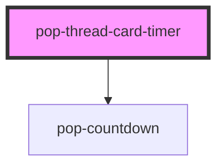

# pop-thread-card-timer

<!-- Auto Generated Below -->

## Overview

pop-thread-card-timer — the Thread Model v2 renderer for a timer / reminder
card.

Live cards compose the shipped `pop-countdown` atom (this component NEVER
reimplements a ticking clock); frozen cards show the finished face instead.
Props in, `popCardAction` out — no Firebase, no fetch.

  payload.data = { fireAt: number; mode: 'timer'|'reminder';
                   durationMs?: number; label?: string }

## Properties

| Property               | Attribute  | Description                                                              | Type                 | Default     |
| ---------------------- | ---------- | ------------------------------------------------------------------------ | -------------------- | ----------- |
| `liveness`             | `liveness` | `frozen` = historical snapshot: muted chrome, no mutating actions.       | `"frozen" \| "live"` | `'live'`    |
| `payload` _(required)_ | --         | The validated card payload object (set as a PROPERTY, not an attribute). | `CardPayload`        | `undefined` |
| `readonly`             | `readonly` | Viewer / public render — no action buttons at all.                       | `boolean`            | `false`     |

## Events

| Event           | Description                                           | Type                            |
| --------------- | ----------------------------------------------------- | ------------------------------- |
| `popCardAction` | Emitted when the user taps one of the card's actions. | `CustomEvent<CardActionDetail>` |

## Dependencies

### Depends on

- [pop-countdown](../../atoms/countdown)

### Graph

----------------------------------------------

*Built with [StencilJS](https://stenciljs.com/)*
