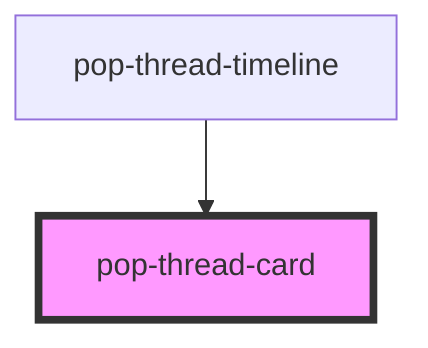

# pop-thread-card

<!-- Auto Generated Below -->

## Overview

pop-thread-card — the Thread Model v2 card WRAPPER.

Every card renderer (`pop-thread-card-timer|task|list|showtimes`, and anything
added later) sits INSIDE this component. The wrapper owns the shared chrome:
the header, the assignee chips, the action row and the frozen treatment; the
renderer owns only the card's own face.

The renderer is INJECTED as a tag name (`renderer="pop-thread-card-timer"`) so
ui-kit never needs a registry of card types — the host maps cardType → tag and
a MISS in that map simply yields no `renderer`. A missing tag, a tag outside
the `pop-*` namespace, or a payload too broken to read all degrade to the
fallback face (title + subtitle + "couldn't render this card"). The wrapper
must NEVER render blank.

Props in, `popCardAction` out. No Firebase, no fetch, no Astro.

## Properties

| Property    | Attribute   | Description                                                                                                                                                                                                         | Type                 | Default     |
| ----------- | ----------- | ------------------------------------------------------------------------------------------------------------------------------------------------------------------------------------------------------------------- | -------------------- | ----------- |
| `actions`   | --          | Wrapper-level actions, before liveness/readonly filtering.                                                                                                                                                          | `CardAction[]`       | `[]`        |
| `assignees` | --          | People the card is assigned to; falls back to `payload.assignees`.                                                                                                                                                  | `CardAssignee[]`     | `[]`        |
| `cardType`  | `card-type` | The card's type key (`timer`, `task`, …). Shown as the chrome's type label.                                                                                                                                         | `string`             | `''`        |
| `liveness`  | `liveness`  | `frozen` = historical snapshot: muted chrome, mutating actions dropped.                                                                                                                                             | `"frozen" \| "live"` | `'live'`    |
| `payload`   | --          | The validated card payload object (set as a PROPERTY, not an attribute). Optional on purpose: a missing or broken payload is a supported state that renders the fallback face, so hosts never have to pre-validate. | `CardPayload`        | `undefined` |
| `readonly`  | `readonly`  | Viewer / public render — no action buttons at all.                                                                                                                                                                  | `boolean`            | `false`     |
| `renderer`  | `renderer`  | The `pop-*` tag to mount inside. Unknown/missing ⇒ fallback face.                                                                                                                                                   | `string`             | `undefined` |

## Events

| Event           | Description                                                                                                                                                                                                                                                                                                                   | Type                            |
| --------------- | ----------------------------------------------------------------------------------------------------------------------------------------------------------------------------------------------------------------------------------------------------------------------------------------------------------------------------- | ------------------------------- |
| `popCardAction` | Emitted when one of the WRAPPER's actions is tapped.  The inner renderer emits its own `popCardAction` with `{ composed: true, bubbles: true }`, so renderer actions reach the same listener by natural propagation — the wrapper deliberately does not intercept and re-dispatch them, which would double-fire every action. | `CustomEvent<CardActionDetail>` |

## Dependencies

### Used by

 - [pop-thread-timeline](../../organisms/thread-timeline)

### Graph

----------------------------------------------

*Built with [StencilJS](https://stenciljs.com/)*
