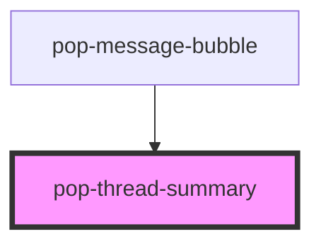

# pop-thread-summary

<!-- Auto Generated Below -->

## Properties

| Property          | Attribute           | Description | Type     | Default |
| ----------------- | ------------------- | ----------- | -------- | ------- |
| `messageId`       | `message-id`        |             | `string` | `''`    |
| `threadAvatarUrl` | `thread-avatar-url` |             | `string` | `''`    |
| `threadCount`     | `thread-count`      |             | `number` | `0`     |
| `threadLastAt`    | `thread-last-at`    |             | `number` | `0`     |
| `threadPreview`   | `thread-preview`    |             | `string` | `''`    |

## Events

| Event             | Description | Type                           |
| ----------------- | ----------- | ------------------------------ |
| `popThreadOpened` |             | `CustomEvent<{ id: string; }>` |

## Dependencies

### Used by

 - [pop-message-bubble](../../organisms/message-bubble)

### Graph

----------------------------------------------

*Built with [StencilJS](https://stenciljs.com/)*
