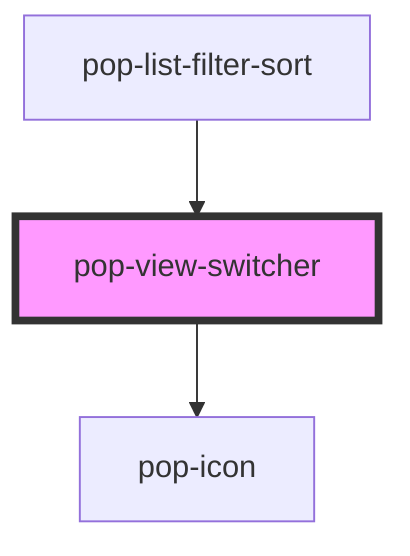

# pop-view-switcher

<!-- Auto Generated Below -->

## Overview

`pop-view-switcher` — the segmented list/card view toggle, generalized to any
subset of list · card · kanban · table.

Each option is a square icon-only button with a centered `pop-icon` and
`aria-pressed`, inside a compact segmented container. Deliberately NOT
`role="group"` — pico.css styles [role=group] as a full-width stretched
button group.

CONTROLLED: the host passes `value` and reacts to `viewChange`.
Expected adopters: the hub photos/tasks/inventory/images dialogs (usually
via the `pop-list-filter-sort` organism).

## Properties

| Property | Attribute | Description                                                                 | Type     | Default             |
| -------- | --------- | --------------------------------------------------------------------------- | -------- | ------------------- |
| `value`  | `value`   | The current view.                                                           | `string` | `''`                |
| `views`  | `views`   | JSON array of views to offer, from 'list' \| 'card' \| 'kanban' \| 'table'. | `string` | `'["list","card"]'` |

## Events

| Event        | Description                                         | Type                  |
| ------------ | --------------------------------------------------- | --------------------- |
| `viewChange` | The user picked a view. Detail = the new view name. | `CustomEvent<string>` |

## Dependencies

### Used by

 - [pop-list-filter-sort](../../organisms/list-filter-sort)

### Depends on

- [pop-icon](../../atoms/icon)

### Graph

----------------------------------------------

*Built with [StencilJS](https://stenciljs.com/)*
