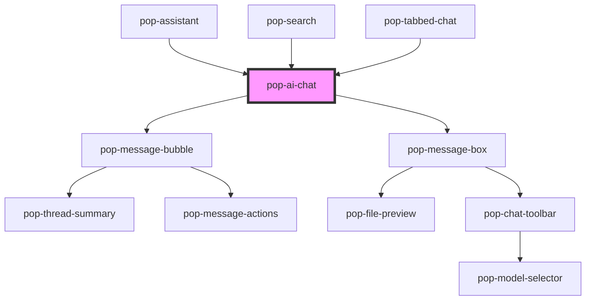

# pop-ai-chat

<!-- Auto Generated Below -->

## Properties

| Property         | Attribute         | Description                                                                                                                                                                                                                                                                                                                                                              | Type                  | Default        |
| ---------------- | ----------------- | ------------------------------------------------------------------------------------------------------------------------------------------------------------------------------------------------------------------------------------------------------------------------------------------------------------------------------------------------------------------------ | --------------------- | -------------- |
| `activeTools`    | `active-tools`    |                                                                                                                                                                                                                                                                                                                                                                          | `string`              | `'[]'`         |
| `aiAccentColor`  | `ai-accent-color` |                                                                                                                                                                                                                                                                                                                                                                          | `string`              | `''`           |
| `aiAvatarUrl`    | `ai-avatar-url`   |                                                                                                                                                                                                                                                                                                                                                                          | `string`              | `''`           |
| `aiName`         | `ai-name`         |                                                                                                                                                                                                                                                                                                                                                                          | `string`              | `'Assistant'`  |
| `context`        | `context`         | Extra context injected into request payload                                                                                                                                                                                                                                                                                                                              | `string`              | `''`           |
| `disabled`       | `disabled`        |                                                                                                                                                                                                                                                                                                                                                                          | `boolean`             | `false`        |
| `endpoint`       | `endpoint`        | POST endpoint that streams SSE: data: {token?, done?, error?, assistantMsgId?}                                                                                                                                                                                                                                                                                           | `string`              | `''`           |
| `externalDriver` | `external-driver` | When true, the host drives the answer instead of the built-in SSE fetch: on send the component emits `popMessageSent` and the host streams tokens via `beginAssistant()` / `appendAssistantToken()` / `endAssistant()`. Used by the notes-app right-dock so chat is backed by the in-browser RAG `askBrain` (retrieval + required citations) rather than a raw endpoint. | `boolean`             | `false`        |
| `layout`         | `layout`          |                                                                                                                                                                                                                                                                                                                                                                          | `"bubble" \| "prose"` | `'bubble'`     |
| `messages`       | `messages`        | JSON string of AiMessage[] — pre-loaded history                                                                                                                                                                                                                                                                                                                          | `string`              | `'[]'`         |
| `models`         | `models`          |                                                                                                                                                                                                                                                                                                                                                                          | `string`              | `'[]'`         |
| `placeholder`    | `placeholder`     |                                                                                                                                                                                                                                                                                                                                                                          | `string`              | `'Message...'` |
| `selectedMode`   | `selected-mode`   |                                                                                                                                                                                                                                                                                                                                                                          | `string`              | `'chat'`       |
| `selectedModel`  | `selected-model`  |                                                                                                                                                                                                                                                                                                                                                                          | `string`              | `''`           |
| `sessionId`      | `session-id`      | Session ID passed through in each request                                                                                                                                                                                                                                                                                                                                | `string`              | `''`           |
| `showMicButton`  | `show-mic-button` |                                                                                                                                                                                                                                                                                                                                                                          | `boolean`             | `false`        |
| `streamingMode`  | `streaming-mode`  |                                                                                                                                                                                                                                                                                                                                                                          | `"dots" \| "inline"`  | `'inline'`     |
| `tools`          | `tools`           |                                                                                                                                                                                                                                                                                                                                                                          | `string`              | `'[]'`         |
| `userAvatarUrl`  | `user-avatar-url` |                                                                                                                                                                                                                                                                                                                                                                          | `string`              | `''`           |
| `userInitials`   | `user-initials`   |                                                                                                                                                                                                                                                                                                                                                                          | `string`              | `''`           |

## Events

| Event                 | Description                                                               | Type                                                                                              |
| --------------------- | ------------------------------------------------------------------------- | ------------------------------------------------------------------------------------------------- |
| `popCitationClick`    | Fired when a source/citation chip is clicked — host navigates to the ref. | `CustomEvent<{ refId: string; index: number; }>`                                                  |
| `popError`            |                                                                           | `CustomEvent<string>`                                                                             |
| `popMessageSent`      |                                                                           | `CustomEvent<{ text: string; sessionId: string; model: string; mode: string; tools: string[]; }>` |
| `popModeChanged`      |                                                                           | `CustomEvent<string>`                                                                             |
| `popModelChanged`     |                                                                           | `CustomEvent<string>`                                                                             |
| `popResponseComplete` |                                                                           | `CustomEvent<{ content: string; sessionId: string; }>`                                            |
| `popToolToggled`      |                                                                           | `CustomEvent<{ id: string; enabled: boolean; }>`                                                  |

## Methods

### `appendAssistantToken(token: string) => Promise<void>`

Host: append a token to the in-flight assistant message.

#### Parameters

| Name    | Type     | Description |
| ------- | -------- | ----------- |
| `token` | `string` |             |

#### Returns

Type: `Promise<void>`

### `beginAssistant() => Promise<void>`

Host: start an assistant turn (shows the streaming bubble).

#### Returns

Type: `Promise<void>`

### `endAssistant(content?: string, citations?: AiCitation[]) => Promise<void>`

Host: finalize the assistant turn with optional grounding citations.

#### Parameters

| Name        | Type           | Description |
| ----------- | -------------- | ----------- |
| `content`   | `string`       |             |
| `citations` | `AiCitation[]` |             |

#### Returns

Type: `Promise<void>`

### `getMessages() => Promise<AiMessage[]>`

#### Returns

Type: `Promise<AiMessage[]>`

### `sendMessage(text: string) => Promise<void>`

#### Parameters

| Name   | Type     | Description |
| ------ | -------- | ----------- |
| `text` | `string` |             |

#### Returns

Type: `Promise<void>`

### `setInputValue(text: string) => Promise<void>`

#### Parameters

| Name   | Type     | Description |
| ------ | -------- | ----------- |
| `text` | `string` |             |

#### Returns

Type: `Promise<void>`

## Dependencies

### Used by

 - [pop-assistant](../assistant)
 - [pop-search](../search)
 - [pop-tabbed-chat](../tabbed-chat)

### Depends on

- [pop-message-bubble](../message-bubble)
- [pop-message-box](../message-box)

### Graph

----------------------------------------------

*Built with [StencilJS](https://stenciljs.com/)*
