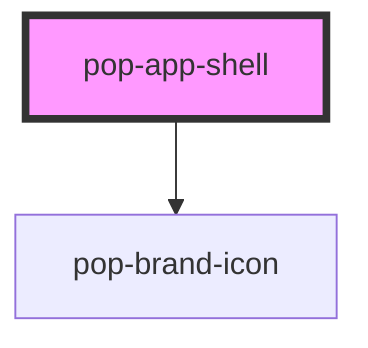

# pop-app-shell

<!-- Auto Generated Below -->

## Overview

pop-app-shell — the shared **page frame** for the notes-app "digital brain".

Every `page-*` used to reinvent its own header markup (title + optional
controls). This organism gives them ONE consistent frame:

  ┌──────────────────────────────────────────────┐
  │ [icon] Title   ‹context slot›     ‹actions slot›│  ← sticky header
  ├──────────────────────────────────────────────┤
  │ ‹default slot — the page body, scrolls›        │
  └──────────────────────────────────────────────┘

Slots:
 - `context` — inline, after the title (e.g. a count badge, a subtitle,
   filter chips). Optional.
 - `actions` — right-aligned controls (buttons, selects, toggles). Optional.
 - default   — the page content; the shell makes it a scroll region so the
   header stays put.

Props let a page set the title + optional leading `pop-brand-icon` without
markup. `bare` drops the header entirely (for pages that own a custom top bar,
like the split-pane Home/Editor) while still getting the frame's flex/scroll
plumbing.

## Properties

| Property       | Attribute       | Description                                                       | Type      | Default     |
| -------------- | --------------- | ----------------------------------------------------------------- | --------- | ----------- |
| `bare`         | `bare`          | Render no header chrome — just the flex/scroll frame.             | `boolean` | `false`     |
| `centered`     | `centered`      | Constrain the body to a readable column and center it (Settings). | `boolean` | `false`     |
| `heading`      | `heading`       | Page title rendered in the header.                                | `string`  | `undefined` |
| `headingLevel` | `heading-level` | Heading level for the title (a11y).                               | `1 \| 2`  | `1`         |
| `iconName`     | `icon-name`     | Optional leading `pop-brand-icon` name shown before the title.    | `string`  | `undefined` |

## Dependencies

### Depends on

- [pop-brand-icon](../../atoms/brand-icon)

### Graph

----------------------------------------------

*Built with [StencilJS](https://stenciljs.com/)*
