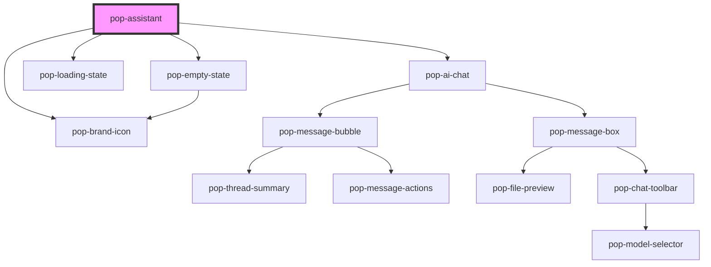

# pop-assistant

<!-- Auto Generated Below -->

## Properties

| Property        | Attribute        | Description                                                                  | Type                         | Default       |
| --------------- | ---------------- | ---------------------------------------------------------------------------- | ---------------------------- | ------------- |
| `buildAction`   | `build-action`   | The Build sub-action label shown on the proposal ("Structure"/"Rewrite"…).   | `string`                     | `'structure'` |
| `buildProposal` | `build-proposal` | A pending Build proposal (JSON AssistantBlock[]) — renders the block diff.   | `string`                     | `''`          |
| `errorMessage`  | `error-message`  | An honest error to surface (e.g. endpoint unreachable).                      | `string`                     | `''`          |
| `layout`        | `layout`         | Compact mode = the desktop dock; full = a page/sheet surface.                | `"dock" \| "full"`           | `'dock'`      |
| `linkProposal`  | `link-proposal`  | A pending Link proposal (JSON AssistantLink[]) — renders the link chips.     | `string`                     | `''`          |
| `messages`      | `messages`       | Pre-loaded Ask conversation (JSON AiMessage[]) restored from the thread.     | `string`                     | `'[]'`        |
| `model`         | `model`          | The single model control's value: Gemma (default) ↔ Claude (toggle).         | `"claude" \| "gemma"`        | `'gemma'`     |
| `noteGrounded`  | `note-grounded`  | True when the Assistant is grounded in an open note (shows the context row). | `boolean`                    | `false`       |
| `noteTitle`     | `note-title`     | Label of the grounding note (for the context row).                           | `string`                     | `''`          |
| `proposing`     | `proposing`      | Show the busy state while the host fetches a Build/Link proposal.            | `boolean`                    | `false`       |
| `verb`          | `verb`           | Active verb (Ask default). Controlled by the host or the internal tabs.      | `"ask" \| "build" \| "link"` | `'ask'`       |

## Events

| Event                       | Description                                                      | Type                                             |
| --------------------------- | ---------------------------------------------------------------- | ------------------------------------------------ |
| `popAssistantApproveBuild`  | Approve a Build proposal → host writes the accepted blocks.      | `CustomEvent<{ blocks: AssistantBlock[]; }>`     |
| `popAssistantApproveLinks`  | Approve a Link proposal → host appends the accepted links.       | `CustomEvent<{ noteIds: string[]; }>`            |
| `popAssistantBuild`         | Build: run a sub-action against the current text/selection.      | `CustomEvent<{ action: string; model: Model; }>` |
| `popAssistantCitationClick` | A citation chip was clicked → host navigates to the ref.         | `CustomEvent<{ refId: string; index: number; }>` |
| `popAssistantModelChange`   |                                                                  | `CustomEvent<"claude" \| "gemma">`               |
| `popAssistantRejectBuild`   | Reject a Build proposal → discard (nothing written).             | `CustomEvent<void>`                              |
| `popAssistantRejectLinks`   | Reject a Link proposal → discard.                                | `CustomEvent<void>`                              |
| `popAssistantSend`          | Ask: a question was submitted (host drives the streamed answer). | `CustomEvent<{ text: string; model: Model; }>`   |
| `popAssistantSuggestLinks`  | Link: on-demand "Suggest links" was invoked.                     | `CustomEvent<{ model: Model; }>`                 |
| `popAssistantVerbChange`    |                                                                  | `CustomEvent<"ask" \| "build" \| "link">`        |

## Methods

### `appendAssistantToken(token: string) => Promise<void>`

Host: append a token to the streaming answer.

#### Parameters

| Name    | Type     | Description |
| ------- | -------- | ----------- |
| `token` | `string` |             |

#### Returns

Type: `Promise<void>`

### `beginAssistant() => Promise<void>`

Host: begin an Ask assistant turn (typing bubble).

#### Returns

Type: `Promise<void>`

### `endAssistant(content?: string, citations?: AssistantCitation[]) => Promise<void>`

Host: finalize the answer with optional citations.

#### Parameters

| Name        | Type                  | Description |
| ----------- | --------------------- | ----------- |
| `content`   | `string`              |             |
| `citations` | `AssistantCitation[]` |             |

#### Returns

Type: `Promise<void>`

### `setAskInput(text: string) => Promise<void>`

Host: seed the Ask input (e.g. from Cmd-K / a selection).

#### Parameters

| Name   | Type     | Description |
| ------ | -------- | ----------- |
| `text` | `string` |             |

#### Returns

Type: `Promise<void>`

## Dependencies

### Depends on

- [pop-brand-icon](../../atoms/brand-icon)
- [pop-ai-chat](../ai-chat)
- [pop-loading-state](../../molecules/loading-state)
- [pop-empty-state](../../molecules/empty-state)

### Graph

----------------------------------------------

*Built with [StencilJS](https://stenciljs.com/)*
