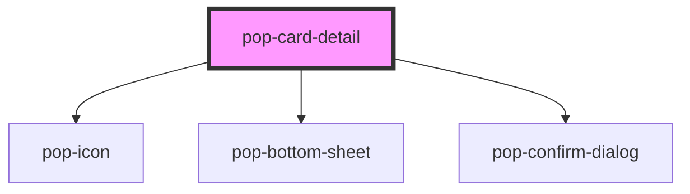

# pop-card-detail

<!-- Auto Generated Below -->

## Overview

`pop-card-detail` — the tap-a-card bottom sheet: the ONE place for
everything about a collection card. Composed on `pop-bottom-sheet`, fully
PRESENTATIONAL: the host passes a plain `card` view-model (JSON attr or
property) and owns every API call — the sheet only emits ONE
`popCardAction` CustomEvent per user intent (`{ action, payload }`), the
same host-owns-IO seam as `pop-list-filter-sort` / `pop-user-select`.

Layout (phone-first, one column): large art (with a thumbnail toggle to the
user's own photo) → identity block (name · set code · rarity · edition ·
condition, needs-review badge) → quantity stepper → price row + refresh →
printing row (chevron → the `printing-picker` slot the HOST fills with its
printings list) → action list (Move to binder · Split stack when quantity
≥ 2 · Delete with confirm).

States: `card.scanState === 'scanning'` renders the READ-ONLY resolving
state (art + name + "resolving printing & price…" + Delete only) — the
worker may merge-and-delete the placeholder at any moment. A needs-review
card leads with the badge + reason and a "Pick the printing" CTA
(`hasPasscode: false` swaps it for Rescan).

Actions emitted (host route mapping lives in the host):
  `qty` {delta} · `refresh-price` · `open-printings` · `set-condition`
  {condition} · `move` {containerId} · `split` {condition} · `delete` ·
  `rescan`

Slots:
  • printing-picker — the host's printings list UI (shown while
    `printingsOpen`; the host lazy-fetches on `open-printings`).
  • actions — host-specific extras appended to the action list.

## Properties

| Property        | Attribute        | Description                                                                                                                                 | Type                              | Default                           |
| --------------- | ---------------- | ------------------------------------------------------------------------------------------------------------------------------------------- | --------------------------------- | --------------------------------- |
| `busy`          | `busy`           | Host is mid-request → mutation controls disable (optional).                                                                                 | `boolean`                         | `false`                           |
| `card`          | `card`           | The card view-model — JSON attr or object property (see CardDetailModel).                                                                   | `CardDetailModel \| string`       | `null`                            |
| `conditions`    | `conditions`     | Condition grades offered by the condition + split pickers (JSON array).                                                                     | `string \| string[]`              | `JSON.stringify(CARD_CONDITIONS)` |
| `containers`    | `containers`     | Binder/container options for Move — JSON attr or array property.                                                                            | `CardContainerOption[] \| string` | `'[]'`                            |
| `open`          | `open`           | Whether the sheet is open (host-controlled).                                                                                                | `boolean`                         | `false`                           |
| `printingsOpen` | `printings-open` | The printing picker area is expanded (host may also drive this, e.g. the needs-review deep-link). Toggled by the printing row / review CTA. | `boolean`                         | `false`                           |

## Events

| Event           | Description                                                         | Type                                                                  |
| --------------- | ------------------------------------------------------------------- | --------------------------------------------------------------------- |
| `popCardAction` | ONE event per user intent; the host owns the API call + revalidate. | `CustomEvent<{ action: string; payload?: Record<string, unknown>; }>` |
| `popCardClose`  | Re-emitted when the sheet closes (backdrop / swipe / Esc / host).   | `CustomEvent<void>`                                                   |

## Dependencies

### Depends on

- [pop-icon](../../atoms/icon)
- [pop-bottom-sheet](../../molecules/bottom-sheet)
- [pop-confirm-dialog](../../molecules/confirm-dialog)

### Graph

----------------------------------------------

*Built with [StencilJS](https://stenciljs.com/)*
