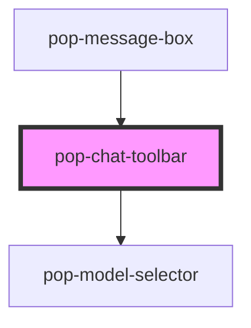

# pop-chat-toolbar

<!-- Auto Generated Below -->

## Properties

| Property        | Attribute         | Description                                                         | Type      | Default  |
| --------------- | ----------------- | ------------------------------------------------------------------- | --------- | -------- |
| `activeTools`   | `active-tools`    | JSON string of string[] — initially active tool IDs                 | `string`  | `'[]'`   |
| `models`        | `models`          | JSON string of ModelGroup[]                                         | `string`  | `'[]'`   |
| `selectedMode`  | `selected-mode`   | Initial/controlled mode                                             | `string`  | `'chat'` |
| `selectedModel` | `selected-model`  | Initial/controlled model value                                      | `string`  | `''`     |
| `showMicButton` | `show-mic-button` | Show mic button in toolbar                                          | `boolean` | `false`  |
| `tools`         | `tools`           | JSON string of ToolDefinition[] (extra tools merged with built-ins) | `string`  | `'[]'`   |

## Events

| Event             | Description | Type                                             |
| ----------------- | ----------- | ------------------------------------------------ |
| `micPressed`      |             | `CustomEvent<void>`                              |
| `micReleased`     |             | `CustomEvent<void>`                              |
| `popModeChanged`  |             | `CustomEvent<string>`                            |
| `popModelChanged` |             | `CustomEvent<string>`                            |
| `popToolToggled`  |             | `CustomEvent<{ id: string; enabled: boolean; }>` |

## Dependencies

### Used by

 - [pop-message-box](../message-box)

### Depends on

- [pop-model-selector](../../molecules/model-selector)

### Graph

----------------------------------------------

*Built with [StencilJS](https://stenciljs.com/)*
