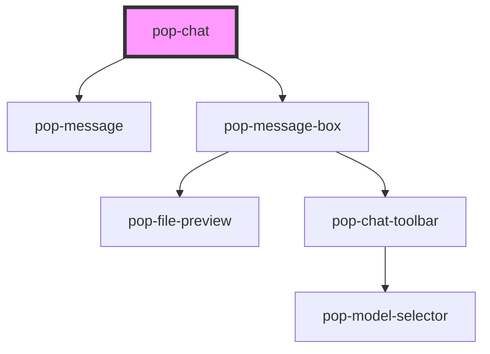

# pop-chat

<!-- Auto Generated Below -->

## Properties

| Property             | Attribute             | Description                                                                        | Type                                | Default                   |
| -------------------- | --------------------- | ---------------------------------------------------------------------------------- | ----------------------------------- | ------------------------- |
| `channelName`        | `channel-name`        | The name of the channel to display                                                 | `string`                            | `'Chat'`                  |
| `currentUserId`      | `current-user-id`     | The ID of the current user (to align messages right)                               | `string`                            | `''`                      |
| `defaultSort`        | `default-sort`        |                                                                                    | `"newest" \| "oldest" \| "popular"` | `'oldest'`                |
| `fullChatLink`       | `full-chat-link`      | The URL for the full chat link                                                     | `string`                            | `'/chat'`                 |
| `guestPlaceholder`   | `guest-placeholder`   |                                                                                    | `string`                            | `'Please log in to chat'` |
| `loginButtonText`    | `login-button-text`   |                                                                                    | `string`                            | `'Login to Chat'`         |
| `messagePlaceholder` | `message-placeholder` |                                                                                    | `string`                            | `''`                      |
| `messages`           | `messages`            | JSON string of messages. Array of { id, text, userDisplayName, userId, createdAt } | `string`                            | `'[]'`                    |
| `mode`               | `mode`                | Mode of the chat: 'channel' (default) or 'thread' (hides thread controls)          | `"channel" \| "thread"`             | `'channel'`               |
| `showFullChatLink`   | `show-full-chat-link` | Whether to show a link to the full chat application in the header                  | `boolean`                           | `false`                   |

## Events

| Event               | Description                                             | Type                                         |
| ------------------- | ------------------------------------------------------- | -------------------------------------------- |
| `popLoadHistory`    | Emitted when the user scrolls to the top of the history | `CustomEvent<void>`                          |
| `popLoginRequested` | Emitted when the user clicks 'Login'                    | `CustomEvent<void>`                          |
| `popMessageDeleted` | Emitted when a message is deleted                       | `CustomEvent<string>`                        |
| `popMessageEdited`  |                                                         | `CustomEvent<{ id: string; text: string; }>` |
| `popMessageSent`    | Emitted when the user attempts to send a message        | `CustomEvent<string>`                        |
| `popThreadOpened`   | Emitted when a user wants to open a thread              | `CustomEvent<any>`                           |

## Dependencies

### Depends on

- [pop-message](../message)
- [pop-message-box](../message-box)

### Graph

----------------------------------------------

*Built with [StencilJS](https://stenciljs.com/)*
