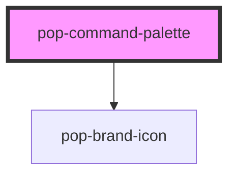

# pop-command-palette

<!-- Auto Generated Below -->

## Properties

| Property      | Attribute     | Description                                                            | Type                         | Default                       |
| ------------- | ------------- | ---------------------------------------------------------------------- | ---------------------------- | ----------------------------- |
| `emptyLabel`  | `empty-label` | Empty-state copy shown when there's a query but no results.            | `string`                     | `'No matches'`                |
| `loading`     | `loading`     | Loading spinner in the input affordance.                               | `boolean`                    | `false`                       |
| `open`        | `open`        | Overlay visibility.                                                    | `boolean`                    | `false`                       |
| `placeholder` | `placeholder` | Placeholder for the input.                                             | `string`                     | `'Search or ask your brain…'` |
| `query`       | `query`       | Current query value (controlled by the host).                          | `string`                     | `''`                          |
| `sections`    | `sections`    | Sections to render. Accepts an array (property) or JSON string (attr). | `PaletteSection[] \| string` | `[]`                          |

## Events

| Event            | Description                                                         | Type                       |
| ---------------- | ------------------------------------------------------------------- | -------------------------- |
| `popAsk`         | Fires on Tab from the input → host expands the Ask flow (Phase 6).  | `CustomEvent<string>`      |
| `popClose`       | Fires when the palette closes (Esc / backdrop / select).            | `CustomEvent<void>`        |
| `popQueryChange` | Fires on every input keystroke (host debounces + runs notesSearch). | `CustomEvent<string>`      |
| `popSelect`      | Fires when a row is activated (Enter / click).                      | `CustomEvent<PaletteItem>` |

## Dependencies

### Depends on

- [pop-brand-icon](../../atoms/brand-icon)

### Graph

----------------------------------------------

*Built with [StencilJS](https://stenciljs.com/)*
