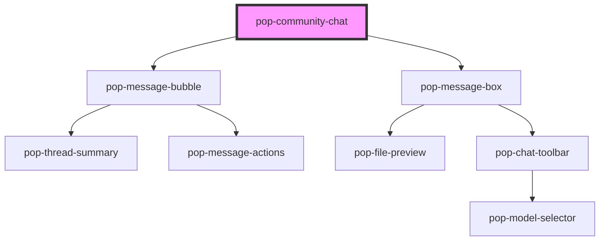

# pop-community-chat

<!-- Auto Generated Below -->

## Properties

| Property             | Attribute             | Description                    | Type                                | Default                   |
| -------------------- | --------------------- | ------------------------------ | ----------------------------------- | ------------------------- |
| `channelName`        | `channel-name`        |                                | `string`                            | `'Chat'`                  |
| `currentUserId`      | `current-user-id`     |                                | `string`                            | `''`                      |
| `defaultSort`        | `default-sort`        |                                | `"newest" \| "oldest" \| "popular"` | `'oldest'`                |
| `fullChatLink`       | `full-chat-link`      |                                | `string`                            | `'/chat'`                 |
| `guestPlaceholder`   | `guest-placeholder`   |                                | `string`                            | `'Please log in to chat'` |
| `loginButtonText`    | `login-button-text`   |                                | `string`                            | `'Login to Chat'`         |
| `messagePlaceholder` | `message-placeholder` |                                | `string`                            | `''`                      |
| `messages`           | `messages`            | JSON string of message objects | `string`                            | `'[]'`                    |
| `mode`               | `mode`                |                                | `"channel" \| "thread"`             | `'channel'`               |
| `showFullChatLink`   | `show-full-chat-link` |                                | `boolean`                           | `false`                   |

## Events

| Event               | Description | Type                                         |
| ------------------- | ----------- | -------------------------------------------- |
| `popLoadHistory`    |             | `CustomEvent<void>`                          |
| `popLoginRequested` |             | `CustomEvent<void>`                          |
| `popMessageDeleted` |             | `CustomEvent<string>`                        |
| `popMessageEdited`  |             | `CustomEvent<{ id: string; text: string; }>` |
| `popMessageSent`    |             | `CustomEvent<string>`                        |
| `popThreadOpened`   |             | `CustomEvent<any>`                           |

## Dependencies

### Depends on

- [pop-message-bubble](../message-bubble)
- [pop-message-box](../message-box)

### Graph

----------------------------------------------

*Built with [StencilJS](https://stenciljs.com/)*
