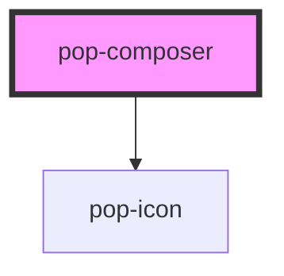

# pop-composer

<!-- Auto Generated Below -->

## Properties

| Property      | Attribute     | Description                                                                                                                                                                                                                                                                                                                           | Type                   | Default      |
| ------------- | ------------- | ------------------------------------------------------------------------------------------------------------------------------------------------------------------------------------------------------------------------------------------------------------------------------------------------------------------------------------- | ---------------------- | ------------ |
| `commands`    | --            | Slash-commands offered by the `/` popover. Pass as a property (not stringified).                                                                                                                                                                                                                                                      | `ComposerCommand[]`    | `[]`         |
| `disabled`    | `disabled`    |                                                                                                                                                                                                                                                                                                                                       | `boolean`              | `false`      |
| `people`      | --            | Family members offered by the `@` popover. Pass as a property.                                                                                                                                                                                                                                                                        | `ComposerPerson[]`     | `[]`         |
| `placeholder` | `placeholder` |                                                                                                                                                                                                                                                                                                                                       | `string`               | `'Message…'` |
| `sendActions` | --            | SECONDARY send actions. When non-empty, a press-and-hold (~450ms, mouse + touch) on the send button opens a small popover ABOVE the button listing these actions. A normal tap (no hold) performs the DEFAULT send (`popSend`); selecting a popover item emits `popSendAction { id, text, … }`. Pass as a PROPERTY (not stringified). | `ComposerSendAction[]` | `[]`         |
| `showAttach`  | `show-attach` |                                                                                                                                                                                                                                                                                                                                       | `boolean`              | `true`       |
| `showMic`     | `show-mic`    |                                                                                                                                                                                                                                                                                                                                       | `boolean`              | `false`      |
| `submitIcon`  | `submit-icon` | Submit-button glyph:  - 'send' (default): the paper-plane arrow (a chat message).  - 'add': a `+` (signals the submit CREATES something — e.g. a new thread).                                                                                                                                                                         | `"add" \| "send"`      | `'send'`     |
| `value`       | `value`       |                                                                                                                                                                                                                                                                                                                                       | `string`               | `''`         |

## Events

| Event             | Description                                                                                                                                                                                                  | Type                                    |
| ----------------- | ------------------------------------------------------------------------------------------------------------------------------------------------------------------------------------------------------------ | --------------------------------------- |
| `popAttach`       | Emitted when images are attached.                                                                                                                                                                            | `CustomEvent<File[]>`                   |
| `popMicDevice`    | Emitted when the active audio-input device changes (mic press-hold popover). Also persisted to localStorage[MIC_DEVICE_KEY] so the consumer's capture can read it. `deviceId === ''` means "System default". | `CustomEvent<{ deviceId: string; }>`    |
| `popMicRequested` | Emitted when the mic button is pressed (consumer wires STT → setValue).                                                                                                                                      | `CustomEvent<void>`                     |
| `popSend`         | Emitted on send (Enter / tap / send button) — the default action.                                                                                                                                            | `CustomEvent<ComposerSendDetail>`       |
| `popSendAction`   | Emitted when a SECONDARY action is chosen from the press-hold popover.                                                                                                                                       | `CustomEvent<ComposerSendActionDetail>` |
| `popTalkBack`     | Emitted when the "Talk back" toggle flips (mic press-hold popover). Persisted to localStorage[TALKBACK_KEY]. Consumer speaks assistant replies when on.                                                      | `CustomEvent<{ on: boolean; }>`         |
| `popValueChange`  | Emitted whenever the text changes.                                                                                                                                                                           | `CustomEvent<string>`                   |

## Methods

### `clear() => Promise<void>`

#### Returns

Type: `Promise<void>`

### `getMicDeviceId() => Promise<string>`

The active mic deviceId ('' = System default) — the consumer's voice capture
should pass it as getUserMedia({ audio: { deviceId: { exact } } }). Reads the
persisted value so it's correct even before the popover is opened.

#### Returns

Type: `Promise<string>`

### `setFocus() => Promise<void>`

#### Returns

Type: `Promise<void>`

### `setValue(text: string) => Promise<void>`

#### Parameters

| Name   | Type     | Description |
| ------ | -------- | ----------- |
| `text` | `string` |             |

#### Returns

Type: `Promise<void>`

## Dependencies

### Depends on

- [pop-icon](../../atoms/icon)

### Graph

----------------------------------------------

*Built with [StencilJS](https://stenciljs.com/)*
