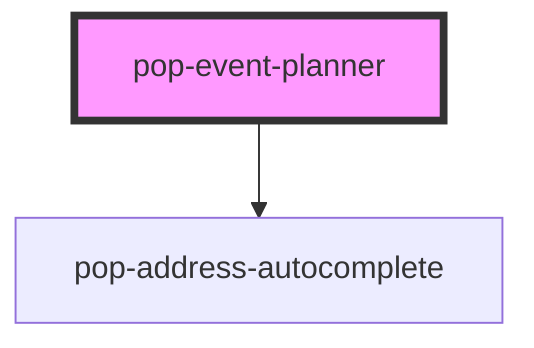

# pop-event-planner

<!-- Auto Generated Below -->

## Properties

| Property          | Attribute          | Description | Type      | Default  |
| ----------------- | ------------------ | ----------- | --------- | -------- |
| `editable`        | `editable`         |             | `boolean` | `false`  |
| `initialAddress`  | `initial-address`  |             | `string`  | `''`     |
| `initialDatetime` | `initial-datetime` |             | `string`  | `''`     |
| `initialName`     | `initial-name`     |             | `string`  | `''`     |
| `initialNotes`    | `initial-notes`    |             | `string`  | `''`     |
| `mapsApiKey`      | `maps-api-key`     |             | `string`  | `''`     |
| `titleText`       | `title-text`       |             | `string`  | `'Plan'` |

## Events

| Event       | Description | Type                                                                               |
| ----------- | ----------- | ---------------------------------------------------------------------------------- |
| `planSaved` |             | `CustomEvent<{ name: string; notes: string; address: string; datetime: string; }>` |

## Dependencies

### Depends on

- [pop-address-autocomplete](../../molecules/address-autocomplete)

### Graph

----------------------------------------------

*Built with [StencilJS](https://stenciljs.com/)*
