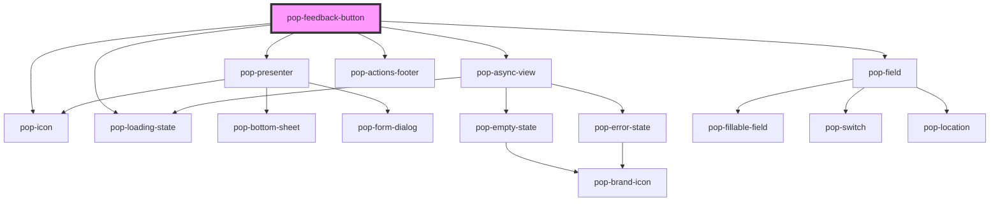

# pop-feedback-button

The feedback-pipeline trigger. It is a *button*, not a form primitive — the
surface it opens is composed from the existing feature-surface set:

| Composed | Role |
|---|---|
| `pop-presenter` | sheet / dialog / dock tiering (used as-is — no new presenter props/events) |
| `pop-field` ×2 | `category` (required select: bug \| feature) and `description` (required text), one `FieldSpec` each |
| `pop-actions-footer` | Cancel/Send, `busy` spinner, `popSubmit`/`popCancel` — never a native form submit |
| `pop-async-view` | loading/error while the submission is in flight |

Only two things here are new: the trigger button and the screenshot control
(`getDisplayMedia()` tab capture — no existing composable does that). The
screenshot is optional and a dismissed picker never blocks submission.

Page context (`url`, `app`, `version`, `viewport`, `userAgent`) is captured
silently at submit time — the submitter types nothing for it. The `app` prop
overrides detection; `submitEndpoint` keeps the POST target out of the
component so the organism can drop into a non-bucket-hub shell.

`popFeedbackSubmit` only fires when the response carries **both** a `taskId`
and a `forgejoIssueNumber`; anything else is shown as the error state.

## Placement

Where the trigger sits is the **host's** decision — `position` (default
`bottom-right`):

| `position` | Renders as |
|---|---|
| `bottom-right` *(default)*, `bottom-left`, `top-right`, `top-left` | a floating button, `position: fixed` to that viewport corner. The host element goes `display: contents`, so it reserves no layout space. |
| `inline` | an ordinary in-flow button — no fixed positioning. Use this inside a toolbar or a panel header. |

A floating trigger's distance from its corner is two CSS custom properties —
**gutters**, not coordinates, so the same pair works for every corner:

| Property | Default | Meaning |
|---|---|---|
| `--pop-feedback-x` | `1rem` | horizontal gutter from the chosen corner |
| `--pop-feedback-y` | `1rem` | vertical gutter from the chosen corner |

Each is **added to the matching `env(safe-area-inset-*)`**, so the button clears
a phone's home indicator / notch without the host doing the arithmetic. Set them
on the element (or any ancestor) from the host's own stylesheet:

```html
<!-- floating, nudged up and in from the bottom-left corner -->
<pop-feedback-button class="my-shell-feedback" position="bottom-left"></pop-feedback-button>

<!-- in a panel header: no fixed positioning, no offsets -->
<pop-feedback-button position="inline" label="New feedback" icon="add-outline"></pop-feedback-button>
```

```css
.my-shell-feedback {
  --pop-feedback-x: 1.5rem;
  --pop-feedback-y: 4.5rem; /* clear a bottom nav bar */
}
```

**bucket-hub deliberately uses `inline`**: floating the trigger over the chat
transcript covered messages on phones, so the hub reaches feedback through a
tile → the `hub-feedback` panel, whose header carries the inline trigger.

<!-- Auto Generated Below -->


## Overview

pop-feedback-button — the "report a bug / request a feature" trigger
(organism) for the feedback pipeline.

It is a TRIGGER, not a form primitive: everything below the button is
composed from the feature-surface set, so this file adds no new form UI —

  pop-presenter      → the sheet/dialog/dock tiering (used as-is: `open` +
                       `heading` in, `tierChange`/`popClose` out; the
                       resolved tier is forwarded to the footer's `tier`)
  pop-field   ×2     → `category` (required select) and `description`
                       (required text), one FieldSpec each
  pop-actions-footer → Cancel/Submit + the `busy` spinner, driven by
                       `popSubmit`/`popCancel` — NEVER a native form submit
  pop-async-view     → loading/error while the submission is in flight

The only genuinely new UI is the trigger itself and the screenshot control
(`getDisplayMedia()` tab capture — no existing composable does that).

Page context (url, app, version, viewport, userAgent) is captured silently at
submit time — zero user effort, per the submitter journey.

Inner events from the composed children are stopped at this boundary and only
`popFeedbackSubmit` leaves the organism, so a host listening on the document
can't mistake the form's `popSubmit`/`popClose` for its own.

PLACEMENT is the host's call (`position`): one of four fixed viewport corners
or `inline` for a toolbar / panel header. See feedback-button.css and the
readme for the two `--pop-feedback-x` / `--pop-feedback-y` gutter overrides.

## Properties

| Property         | Attribute         | Description                                                                                                                                                                                                                                                                                                                                                                                                                                                                                                                                                                                                                                                                                                                                                                        | Type                                                                                                  | Default               |
| ---------------- | ----------------- | ---------------------------------------------------------------------------------------------------------------------------------------------------------------------------------------------------------------------------------------------------------------------------------------------------------------------------------------------------------------------------------------------------------------------------------------------------------------------------------------------------------------------------------------------------------------------------------------------------------------------------------------------------------------------------------------------------------------------------------------------------------------------------------- | ----------------------------------------------------------------------------------------------------- | --------------------- |
| `app`            | `app`             | Which app is submitting. Defaults to the auto-captured page context (`<html data-app>` / `<meta name="app">` / hostname); set it to override.                                                                                                                                                                                                                                                                                                                                                                                                                                                                                                                                                                                                                                      | `string`                                                                                              | `''`                  |
| `authToken`      | `auth-token`      | Bearer token for the submission POST, sent as an `Authorization` header. Hosts that authenticate with cookies can leave this empty — `credentials` already carries them. Prefer this over a `?token=` on `submitEndpoint`: query strings land in server access logs and `Referer` headers, and a POST can set a header, unlike an ``.                                                                                                                                                                                                                                                                                                                                                                                                                                     | `string`                                                                                              | `''`                  |
| `heading`        | `heading`         | Presenter heading.                                                                                                                                                                                                                                                                                                                                                                                                                                                                                                                                                                                                                                                                                                                                                                 | `string`                                                                                              | `'Send feedback'`     |
| `icon`           | `icon`            | Trigger ionicon (pop-icon name).                                                                                                                                                                                                                                                                                                                                                                                                                                                                                                                                                                                                                                                                                                                                                   | `string`                                                                                              | `'megaphone-outline'` |
| `label`          | `label`           | Trigger label. Empty renders an icon-only square hit area.                                                                                                                                                                                                                                                                                                                                                                                                                                                                                                                                                                                                                                                                                                                         | `string`                                                                                              | `'Feedback'`          |
| `position`       | `position`        | Where the TRIGGER sits: one of the four viewport corners (fixed, floating, safe-area aware) or `'inline'` for an in-flow button in a toolbar / panel header. Nudge a floating trigger with `--pop-feedback-x` / `--pop-feedback-y` (gutters from the chosen corner, default `1rem`).                                                                                                                                                                                                                                                                                                                                                                                                                                                                                               | `"bottom-left" \| "bottom-right" \| "inline" \| "top-left" \| "top-right"`                            | `'bottom-right'`      |
| `submitEndpoint` | `submit-endpoint` | Where the submission POSTs. A prop (not a constant) so the organism can be dropped into a non-bucket-hub shell later without a hardcoded target.                                                                                                                                                                                                                                                                                                                                                                                                                                                                                                                                                                                                                                   | `string`                                                                                              | `'/api/hub/feedback'` |
| `submitter`      | --                | Injected submit. When set it REPLACES the `fetch` entirely — the organism never touches `submitEndpoint`/`authToken` — so a host can submit however it likes (the Firestore `feedback` collection, an app-specific client, a test double) without ui-kit ever importing Firebase. Same injected-dependency shape as `pop-user-select`'s resolver.  Return a `FeedbackSubmitResult` when the task/issue are already known (synchronous filing); return nothing when the submission was merely QUEUED for async intake — the organism then emits `{ queued: true }` so the host can say "sent" instead of inventing an issue number.  Throw to surface an error: the message is shown in the form and the report is NOT lost — the presenter stays open with the user's text intact. | `(body: FeedbackSubmission) => void \| FeedbackSubmitResult \| Promise<void \| FeedbackSubmitResult>` | `undefined`           |


## Events

| Event               | Description                                                       | Type                                |
| ------------------- | ----------------------------------------------------------------- | ----------------------------------- |
| `popFeedbackSubmit` | Fired after a successful submission, for hosts that want a toast. | `CustomEvent<FeedbackSubmitResult>` |


## Dependencies

### Depends on

- [pop-icon](../../atoms/icon)
- [pop-presenter](../presenter)
- [pop-async-view](../../molecules/async-view)
- [pop-loading-state](../../molecules/loading-state)
- [pop-field](../../molecules/field)
- [pop-actions-footer](../../molecules/actions-footer)

### Graph


----------------------------------------------

*Built with [StencilJS](https://stenciljs.com/)*
